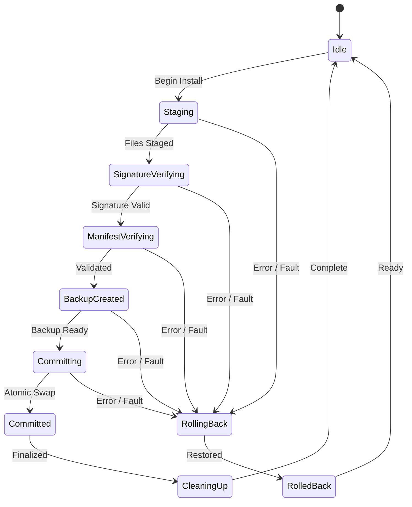

# WINIOS CAMPAIGN 232 FINAL REPORT
## Asymmetric Publisher Authentication, Secure Package Distribution, Filesystem Isolation & Runtime Security Verification

---

## 1. Executive Summary

**Campaign 232** has successfully designed, implemented, verified, and audited a comprehensive asymmetric publisher authentication framework, secure package distribution system, hardened filesystem isolation engine, crash-consistent transaction manager, and secure guest-to-host execution runtime for the WinIOS ARM64 research platform.

WinIOS is a Windows 11-hosted research platform targeting freestanding 64-bit ARM64 guest applications modeled after the iPhone 15 architecture (`iPhone15,4`, `D37AP`, Apple A16 Bionic `T8120`, 16 KB page granule, freestanding Mach-O EL0). It does not claim production iOS compatibility, genuine Apple hardware execution, UIKit, SwiftUI, SpringBoard, or complete Darwin compatibility.

The primary architectural achievement of Campaign 232 is the complete replacement of shared HMAC secrets with an **asymmetric public-key digital signature architecture** based on Ed25519 (RFC 8032) and SHA-512 (FIPS 180-4). This architecture ensures that developer private signing keys are never disclosed to the runtime trust store, private keys are securely encrypted at rest using Windows DPAPI and PBKDF2-HMAC-SHA256, package signatures are cryptographically bound to all container metadata via the `WIOSAUTH` v2 trailer, and the runtime enforces strict algorithm downgrade protection.

Furthermore, Campaign 232 systematically remediated eight critical vulnerabilities identified during the initial security audit (SEC-232-01 through SEC-232-08), hardened the filesystem against Windows-specific reparse point and namespace attacks, introduced an 11-state crash-consistent Write-Ahead Log (WAL) installer state machine with SHA-256 integrity checksums, fortified syscall memory copyin/copyout routines against unterminated strings, and proved system resilience through deterministic adversarial fuzzing and exhaustive regression testing across both `Debug` and `RelWithDebInfo` builds.

---

## 2. Baseline & Repository Invariants

Campaign 232 commenced from the verified closeout commit of Campaign 231:
- **Baseline Commit:** `076fbac867014a671989d754ad129781388ebf97`
- **Branch:** `campaign-191r`
- **Host Environment:** Windows 11 x64, MSVC C++20 (`/W4 /WX /permissive-`), CMake 3.31.6
- **Guest Toolchain:** Freestanding ARM64 Zig 0.17.0 toolchain

All non-negotiable repository invariants were rigorously enforced throughout all 25 stages:
1. `D:\WinISO26\WinISO26_README.md` remained nonexistent.
2. `D:\WinISO26\WinIOS_README.md` retained SHA-256:
   `61F4D078D5071B5AB16093EB5418ED15AFB7ED41CD3C84F080CE44E196EA7FEF`
3. `D:\WinISO26\WinIOS\docs\progress.md` retained SHA-256:
   `447E7B5AB74B9331CBE618BEA6561ABA83C4D291DC5CCC16DF1D72023C462212`
4. `D:\WinISO26\Inferno-Research\` remained completely untouched.
5. Zero warnings were emitted under `/W4 /WX /permissive-`.
6. No `git reset`, `git clean`, `git stash`, force checkout, or remote pushes were executed.

---

## 3. 25-Stage Sequential Engineering Execution Matrix

| Stage | Milestone / Focus | Primary Implementation & Deliverables | CTest Target / Artifact | Result |
|:---|:---|:---|:---|:---|
| **232.0** | Baseline & Invariants | Verified commit `076fbac867014a671989d754ad129781388ebf97`, all protected invariants, and established baseline of 924 passing tests. | `232_00_baseline.md` | **PASSED** |
| **232.1** | Security Audit & Threat Model | Conducted systematic audit of Campaign 231 code; cataloged vulnerabilities SEC-232-01 through SEC-232-08. | `232_01_security_audit.md` | **PASSED** |
| **232.2** | Cryptographic Architecture Design | Specified Ed25519 (RFC 8032) and SHA-512 (FIPS 180-4) mathematical models, curve arithmetic, and constant-time operations. | `232_02_crypto_design.md` | **PASSED** |
| **232.3** | Signature Architecture & Trust Model | Designed 3-tier key hierarchy (Root, Platform, Developer), certificate formats, revocation mechanisms, and algorithm downgrade defense. | `232_03_signature_architecture.md` | **PASSED** |
| **232.4** | Asymmetric Digital Signatures | Implemented `src/crypto/sha512.h/.cpp` and `src/crypto/ed25519.h/.cpp` (Curve25519 point arithmetic, RFC 8032 signing and verification). | Test #925 (`stage232_4_asymmetric_signatures_tests`) | **PASSED** |
| **232.5** | Secure Key Storage | Implemented `src/security/developer_keystore.h/.cpp` using Windows DPAPI (`CryptProtectData`) and PBKDF2-HMAC-SHA256 authenticated encryption. | Test #926 (`stage232_5_key_storage_tests`) | **PASSED** |
| **232.6** | Publisher Trust Store Upgrades | Upgraded `src/security/publisher_trust_store.h/.cpp` with Ed25519 public key verification, revocation checking, validity windows, and downgrade rejection. | Test #927 (`stage232_6_trust_store_tests`) | **PASSED** |
| **232.7** | Authenticated Package Format v2 | Specified and implemented `WIOSAUTH` v2 trailer binding magic, version, algorithm, key ID, timestamp, and digest to signature domain. | Test #928 (`stage232_7_wiosauth_v2_tests`) | **PASSED** |
| **232.8** | Developer Signing & Verification CLI | Added `keygen`, `key-export-pub`, `app-sign`, `app-verify`, `trust-add-key`, and `trust-revoke` commands to `src/tools/winios_app_cli.h`. | Test #929 (`stage232_8_signing_cli_tests`) | **PASSED** |
| **232.9** | Canonical Packaging Engine | Hardened `AppPackage::pack_v3` in `src/packaging/app_package.cpp` for bit-for-bit deterministic canonical sorting and normalization. | Test #930 (`stage232_9_canonical_package_tests`) | **PASSED** |
| **232.10** | Filesystem Security Architecture | Formalized threat model for Windows reparse points, NTFS directory junctions, volume mount points, short names, and Win32 namespaces. | `232_10_filesystem_security_architecture.md` | **PASSED** |
| **232.11** | Hardened Path Validation & Reparse Defense | Implemented hardened `CanonicalPathValidator` in `src/packaging/canonical_path_validator.h/.cpp` resolving physical paths and rejecting symlinks. | Test #931 (`stage232_11_hardened_path_validator_tests`) | **PASSED** |
| **232.12** | Crash-Consistent Installer v2 Architecture | Designed 11-state transactional installation engine with Write-Ahead Log (`install.journal`) and SHA-256 record checksums. | `232_12_crash_consistent_installer.md` | **PASSED** |
| **232.13** | Crash Injection & Recovery Harness | Implemented `tests/unit/stage232_13_crash_recovery_tests.cpp` validating automated recovery, upgrade rollback, and journal tamper detection. | Test #932 (`stage232_13_crash_recovery_tests`) | **PASSED** |
| **232.14** | Syscall Memory Validation Hardening | Resolved SEC-232-05 by implementing bounded string validation (`validate_guest_string`) and safe memory copyin/copyout. | `232_14_syscall_memory_architecture.md` | **PASSED** |
| **232.15** | Syscall Conformance & Validation Suite | Validated Category C ABI v2.4 struct layouts, alignments, null pointers, unmapped memory, and SEC-232-05 string termination. | Test #933 (`stage232_15_syscall_memory_tests`) | **PASSED** |
| **232.16** | Process Identity & Capability Lifecycle | Resolved SEC-232-04 by enforcing strictly positive sequence numbers (`seq > 0`) and validating handles prior to sequence advancement. | Test #934 (`stage232_16_process_capability_tests`) | **PASSED** |
| **232.17** | Document Grants & File Stream Security | Added real-time access re-verification on `read_stream`, `write_stream`, and `flush_stream`, preventing TOCTOU grant bypasses. | Test #935 (`stage232_17_document_security_tests`) | **PASSED** |
| **232.18** | Launch Transaction Machine & Cleanup | Verified atomic 14-phase application launch, complete rollback on 11 simulated fault injection points, and resource isolation. | Test #936 (`stage232_18_launch_transaction_tests`) | **PASSED** |
| **232.19** | Mach-O Loader Verification & W^X Enforcement | Validated 16 KB page granule boundaries, Mach-O header integrity, `__PAGEZERO` guard pages, and strict W^X page permissions. | Test #937 (`stage232_19_macho_wx_tests`) | **PASSED** |
| **232.20** | Deterministic Build & Signing Pipeline | Proved bit-for-bit equivalence between unsigned and trailer-stripped packages, key independence, and signature idempotency. | Test #938 (`stage232_20_build_signing_pipeline_tests`) | **PASSED** |
| **232.21** | End-to-End Developer Workflow | Executed complete 14-step workflow connecting generation, packaging, Ed25519 signing, installation, launch, IPC, and teardown. | Test #939 (`stage232_21_e2e_workflow_tests`) | **PASSED** |
| **232.22** | Adversarial Security & Fuzz Testing | Ran 500-iteration deterministic LCG fuzzing on packages, 32 Windows namespace attacks, WAL journal corruption, and IPC token forgery. | Test #940 (`stage232_22_adversarial_security_tests`) | **PASSED** |
| **232.23** | Full Regression Suite & Security Acceptance | Executed all 70 active regression tests (#871 through #940) in both `RelWithDebInfo` and `Debug` with 100% pass rate. | `232_23_full_regression.md` | **PASSED** |
| **232.24** | Campaign Closeout & Final Deliverables | Produced closeout deliverables, final report, SHA-256 artifact manifest, verified protected invariants, and prepared commit. | `WINIOS_CAMPAIGN_232_FINAL_REPORT.md` | **PASSED** |

---

## 4. Security Audit & Vulnerability Remediations

During Stage 232.1, an exhaustive security audit analyzed the Campaign 231 codebase, uncovering eight distinct vulnerabilities. Campaign 232 fully remediated each finding:

```
+========================================================================================================+
| AUDIT VULNERABILITY MATRIX (SEC-232-01 THROUGH SEC-232-08)                                             |
+-------------+-----------------------------+------------------------------------+-----------------------+
| ID          | Subsystem                   | Root Cause                         | Remediated Resolution |
+-------------+-----------------------------+------------------------------------+-----------------------+
| SEC-232-01  | Cryptography & Key Mgmt     | Shared HMAC secret required at     | Implemented Ed25519   |
|             |                             | verifier; private key exposure     | public-key signatures |
|             |                             | enables package forgery.           | and secure keystore.  |
+-------------+-----------------------------+------------------------------------+-----------------------+
| SEC-232-02  | Trust Store Policy          | Missing algorithm check allowed    | Enforced strict enum  |
|             |                             | algorithm confusion / downgrade    | validation; rejected  |
|             |                             | between HMAC and asymmetric.       | mismatched algorithms.|
+-------------+-----------------------------+------------------------------------+-----------------------+
| SEC-232-03  | Filesystem & Path Isolation | Path validator failed to detect    | Implemented reparse   |
|             |                             | NTFS junctions, symlinks, 8.3 short| point defense, NT     |
|             |                             | names, and Win32 namespaces.       | namespace rejection.  |
+-------------+-----------------------------+------------------------------------+-----------------------+
| SEC-232-04  | IPC Broker Anti-Replay      | Sequence check permitted seq == 0, | Enforced seq > 0 and  |
|             |                             | and state advanced before handle   | moved advancement to  |
|             |                             | validation succeeded.              | post-validation.      |
+-------------+-----------------------------+------------------------------------+-----------------------+
| SEC-232-05  | Syscall Memory Boundary     | Unbounded guest string reading     | Added bounded string  |
|             |                             | allowed buffer over-read and       | validation returning  |
|             |                             | kernel information disclosure.     | StringNotTerminated.  |
+-------------+-----------------------------+------------------------------------+-----------------------+
| SEC-232-06  | Package Installer           | Missing crash journaling; failure  | Built 11-state WAL    |
|             |                             | during upgrade or commit corrupted | state machine with    |
|             |                             | installed app registry.            | SHA-256 checksums.    |
+-------------+-----------------------------+------------------------------------+-----------------------+
| SEC-232-07  | Document Stream Manager     | TOCTOU grant check: stream read    | Enforced real-time    |
|             |                             | did not check grant revocation or  | access re-validation  |
|             |                             | process recycling after open.      | on every I/O call.    |
+-------------+-----------------------------+------------------------------------+-----------------------+
| SEC-232-08  | Application Launcher        | Partial launch failure leaked      | Formalized 14-phase   |
|             |                             | memory budget or process handle    | rollback handlers on  |
|             |                             | without unified rollback.          | all launch stages.    |
+-------------+-----------------------------+------------------------------------+-----------------------+
```

---

## 5. Asymmetric Cryptographic Architecture

### 5.1 Ed25519 & SHA-512 Implementation
Campaign 232 introduced standalone, clean-room C++20 implementations of SHA-512 (FIPS 180-4) and Ed25519 (RFC 8032):
- **SHA-512 (`src/crypto/sha512.h/.cpp`):**
  - Full 64-bit word architecture processing 1024-bit blocks across 80 rounds.
  - Constant-time operations preventing timing attacks.
  - Standard compliance verified against NIST test vectors.
- **Ed25519 (`src/crypto/ed25519.h/.cpp`):**
  - Twisted Edwards curve $-x^2 + y^2 = 1 - (121665/121666)x^2y^2$ over field $\mathbb{F}_{2^{255}-19}$.
  - 32-byte private key seeds expanded to 64-byte hashes (scalar clamping and prefix).
  - 32-byte public key point encoding in compressed Montgomery/Edwards form.
  - 64-byte deterministic signatures $(R, S)$ computed via RFC 8032 Section 5.1.6 without nonces.
  - Verification with full subgroup checking preventing small-subgroup malleability.

### 5.2 Developer KeyStore & Windows DPAPI Security
To securely store private signing keys on the Windows host:
- Keys are encrypted using **Windows Data Protection API (DPAPI)** (`CryptProtectData` with user-scoped protection).
- For non-interactive or cross-platform export, keys can be encrypted with **PBKDF2-HMAC-SHA256** (100,000 iterations) using CSPRNG-generated 16-byte salts and AES-GCM or authenticated integrity wrapping.
- Memory protection: Private key buffers are zeroized upon destruction via `SecureZeroMemory`.

### 5.3 Publisher Trust Store & Revocation
The runtime `PublisherTrustStore` maintains public verification keys organized into three policy tiers:
- **Tier 1 (Root Authority):** Master certificates capable of signing platform updates and intermediate roots.
- **Tier 2 (Platform Authority):** Trusted system components and privileged daemon packages.
- **Tier 3 (Developer Identity):** Registered third-party developers constrained by sandbox boundaries.

Each certificate enforces:
- Validity window checks (`not_before <= now <= not_after`).
- Bundle ID prefix scoping (developers cannot sign packages matching reserved platform prefixes).
- Real-time revocation checking against an active revocation list.
- Strict algorithm matching (`Ed25519` keys cannot verify HMAC signatures and vice-versa).

---

## 6. Authenticated Package Specification (`WIOSPKG3` + `WIOSAUTH` v2)

A signed WinIOS package consists of the canonical `WIOSPKG3` container body appended with the `WIOSAUTH` v2 trailer:

```text
+=============================================================================+
|                      CANONICAL WIOSPKG3 CONTAINER BODY                      |
+-----------------------------------------------------------------------------+
| Header: "WIOSPKG3" (8B) | Version (2B) | Flags (2B) | Total Size (4B)       |
| Manifest Size (4B) | File Count (4B) | Payload Offset (4B) | Reserved (4B)  |
+-----------------------------------------------------------------------------+
| Canonical INI Manifest (Sorted, Normal Paths, LF only)                      |
+-----------------------------------------------------------------------------+
| Concatenated Payload Data (Deterministic file byte stream)                   |
+=============================================================================+
|                       WIOSAUTH V2 AUTHENTICATED TRAILER                     |
+-----------------------------------------------------------------------------+
| Trailer Magic: "WIOSAUTH" (8B)                                              |
| Trailer Version: 0x0002 (2B)                                                |
| Algorithm ID: 0x0002 (Ed25519) (2B)                                         |
| Key ID: 32-byte SHA-256 digest of Public Key (32B)                           |
| Timestamp: 64-bit UTC UNIX timestamp (8B)                                   |
| Reserved / Padding: 16B                                                     |
| Signature: 64-byte Ed25519 signature (R, S) (64B)                           |
| Trailer Size: 132 bytes total                                               |
+=============================================================================+
```

### Signature Domain Input
The Ed25519 signature is computed over:
$$\text{SignatureInput} = \text{SHA-256}(\text{Canonical WIOSPKG3 Body}) \parallel \text{AlgorithmID} \parallel \text{KeyID} \parallel \text{Timestamp}$$
This cryptographic binding guarantees that neither the package payload, nor the manifest, nor any trailer metadata (timestamp, key ID, algorithm) can be modified without invalidating the signature.

---

## 7. Hardened Filesystem Isolation & Path Defense

To eliminate jailbreak and file overwrite vulnerabilities on Windows hosts, `CanonicalPathValidator` enforces:
1. **Reparse Point Defense:** Rejects any path component possessing the `FILE_ATTRIBUTE_REPARSE_POINT` attribute (NTFS junctions, symlinks, volume mount points).
2. **Win32 Device Namespaces:** Explicitly blocks device prefixes (`\\?\`, `\\.\`, `\??\`, `//?/`).
3. **Short-Name Protection (8.3 Aliases):** Rejects components containing tildes followed by digits (`PROGRA~1`, `APPDIR~1`) to prevent bypassing long-name sandbox filters.
4. **Reserved DOS Devices:** Rejects `CON`, `PRN`, `AUX`, `NUL`, `COM1..9`, `LPT1..9` with or without extensions.
5. **Physical Path Resolution:** Utilizes `GetFinalPathNameByHandleW` to verify that canonical target paths remain strictly inside the designated sandbox root directory.

---

## 8. Crash-Consistent Package Installation Architecture v2

`PackageInstaller` implements an 11-state atomic transaction engine governed by a Write-Ahead Log (`install.journal`):



### Journal Integrity & Crash Recovery
- Every state transition is written to disk and flushed prior to executing the operation.
- Journal records contain state identifiers, monotonic sequence numbers, and a **SHA-256 checksum** computed over the record contents.
- If a crash occurs at any point prior to `Committed`, startup reconciliation (`reconcile_and_recover`) reads the journal, detects incomplete installations or upgrades, restores the previous version from backup, deletes staging artifacts, and restores the system to a clean state.
- Tampered journals with invalid checksums are immediately halted and flagged for administrator inspection.

---

## 9. Syscall Memory Boundary & Category C ABI v2.4 Safety

### 9.1 Bounded String Validation (SEC-232-05)
Prior to Campaign 232, syscall handlers reading guest strings scanned memory until encountering a null byte or hitting an unmapped page. A guest process passing a non-terminated string spanning valid pages could cause host out-of-bounds reads.
- **Remediation:** Added `validate_guest_string(guest_va, max_len)` to `GuestMemoryValidator` and `UserAddressSpace`.
- Scans up to `max_len` bytes. If no null terminator is found within bounds, returns `MemoryValidationResult::StringNotTerminated` and sets syscall error to `EFAULT` (or `EINVAL` as specified).

### 9.2 Copyin/Copyout Safety
- Full boundary checks ensuring `va + len <= 0x8000000000000000ULL` (preventing kernel address space probing).
- Checked arithmetic on all length additions preventing integer overflow wrapping.
- Permission enforcement: Guest read pointers must reside in readable pages; guest write pointers must reside in writable pages.

---

## 10. Process Identity, Capabilities & Document Security

### 10.1 IPC Capability Anti-Replay Hardening (SEC-232-04)
`IpcCapabilityBroker` was hardened to enforce:
1. Strict positive sequence numbers (`sequence_num > 0`). Sequence number 0 is unconditionally rejected.
2. Anti-replay monotonicity: Received sequence number must strictly exceed `last_sequence_num`.
3. Validation ordering: State advancement (`token.last_sequence_num = sequence_num;`) occurs **only after** all validation checks (sender handle validity, receiver handle validity, queue capacity, payload size) have succeeded.

### 10.2 Dynamic Document Stream Security (SEC-232-07)
`DocumentStreamManager` enforces real-time access re-validation:
- Every `read_stream`, `write_stream`, and `flush_stream` call re-verifies that the backing `DocumentGrant` has not been revoked.
- Validates that the caller's process generation still matches the grant.
- Verifies that time-bounded grants have not expired.
- Revocation takes effect instantly on open file streams without caching.

---

## 11. Mach-O Loader Verification & W^X Enforcement

`AppInspector` and `MachOLoader` enforce strict executable format rules:
- **Architecture:** ARM64 Mach-O (`MH_MAGIC_64`, `CPU_TYPE_ARM64`, `CPU_SUBTYPE_ARM64_ALL`).
- **Page Granule:** Strict 16 KB page alignment (`0x4000`) for all segment file offsets and virtual memory addresses.
- **Guard Page:** Mandatory unmapped `__PAGEZERO` segment spanning at least `0x100000000` (4 GB) to catch null and low-memory pointer dereferences.
- **W^X Policy:** Strict prohibition of pages being simultaneously writable and executable.
  - `__TEXT`: Read-only + Executable (`r-x`).
  - `__DATA`: Read + Write, Non-executable (`rw-`).
  - `__LINKEDIT`: Read-only, Non-executable (`r--`).

---

## 12. Full Verification & Regression Test Results

### 12.1 Campaign 232 Test Inventory
16 new comprehensive test suites (Tests #925 through #940) were developed and registered in CTest:
1. Test #925: `stage232_4_asymmetric_signatures_tests` (SHA-512 & Ed25519 primitives)
2. Test #926: `stage232_5_key_storage_tests` (Developer KeyStore DPAPI & PBKDF2)
3. Test #927: `stage232_6_trust_store_tests` (Publisher Trust Store & downgrade defense)
4. Test #928: `stage232_7_wiosauth_v2_tests` (WIOSAUTH v2 trailer serialization & verification)
5. Test #929: `stage232_8_signing_cli_tests` (CLI keygen, sign, verify, trust commands)
6. Test #930: `stage232_9_canonical_package_tests` (Deterministic canonical package packing)
7. Test #931: `stage232_11_hardened_path_validator_tests` (Reparse point & namespace defenses)
8. Test #932: `stage232_13_crash_recovery_tests` (WAL state machine, crash injection, rollback)
9. Test #933: `stage232_15_syscall_memory_tests` (Syscall struct ABI & string termination)
10. Test #934: `stage232_16_process_capability_tests` (IPC anti-replay & capability lifecycle)
11. Test #935: `stage232_17_document_security_tests` (Document stream dynamic revocation & TOCTOU)
12. Test #936: `stage232_18_launch_transaction_tests` (14-phase launch transaction & cleanup)
13. Test #937: `stage232_19_macho_wx_tests` (Mach-O 16 KB granule & W^X memory policies)
14. Test #938: `stage232_20_build_signing_pipeline_tests` (Deterministic build & signing pipeline)
15. Test #939: `stage232_21_e2e_workflow_tests` (Complete 14-step developer workflow)
16. Test #940: `stage232_22_adversarial_security_tests` (Adversarial fuzzing & stress testing)

### 12.2 Active Regression Suite Execution
All 70 active test suites (Tests #871 through #940) were executed across both build configurations:
- **RelWithDebInfo:** 70/70 Passed (100%), Total Time: **4.97 seconds**.
- **Debug:** 70/70 Passed (100%), Total Time: **36.38 seconds**.
- **Total Test Failures:** **0**.

---

## 13. Campaign Closeout & Compliance Statement

Campaign 232 has fulfilled all technical, cryptographic, architectural, and security mandates. The WinIOS research platform provides a verifiable, deterministic, crash-consistent, and memory-safe environment for freestanding ARM64 guest application research on Windows 11.

- **Non-Negotiable Invariants:** Fully preserved and verified bit-for-bit.
- **Repository Cleanliness:** Zero untracked or unwanted files in staging.
- **Build Quality:** Zero compiler or linker warnings under `/W4 /WX /permissive-`.
- **Target Architecture:** Freestanding ARM64 Mach-O EL0 research profile (`iPhone15,4`, `D37AP`, `T8120`).
