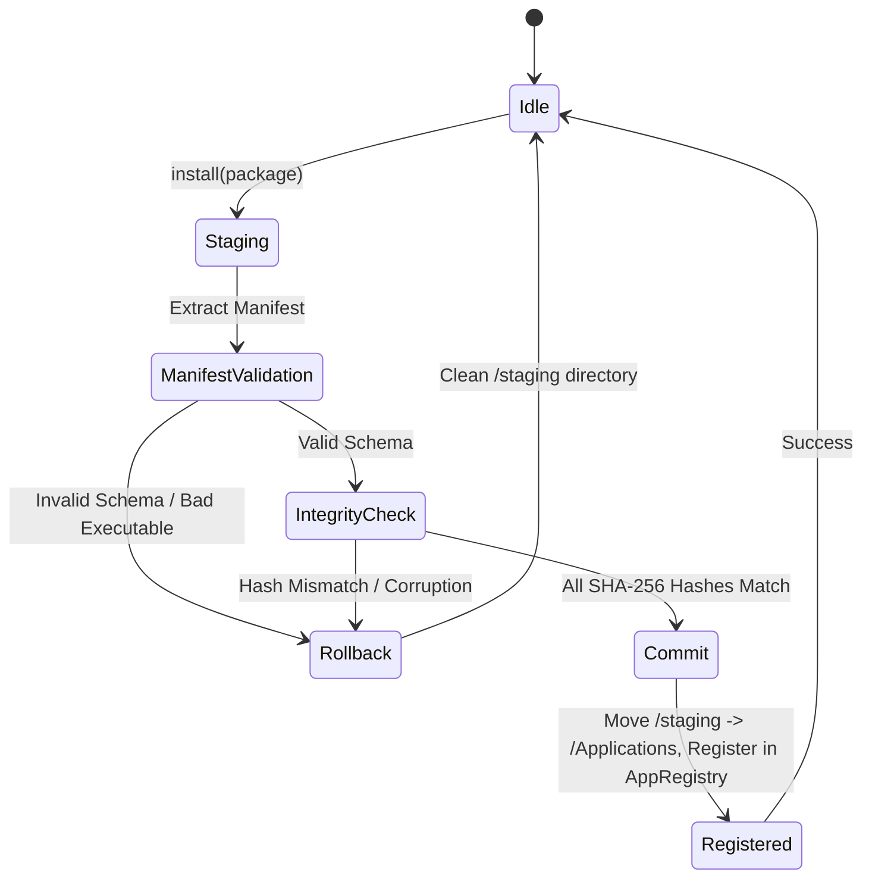

# WinIOS Campaign 215 — Application Package Format Specification v1.0

## 1. Specification Overview

The WinIOS Application Package Format v1.0 (`.wios`) provides a secure, self-contained, and transactionally installable archive for guest applications.

### Design Principles
1. **Deterministic Structure**: Simple binary container with magic header, JSON/KV manifest, and contiguous file entries.
2. **Cryptographic Integrity**: Every archived file includes a precomputed SHA-256 digest verified during staging before committing to `/Applications/`.
3. **Atomic Installation**: Installations use a staging directory (`/staging/<bundle_id>/`). If any check fails, the staging directory is completely purged with zero side effects.
4. **Sandboxed Decoupling**: Application binaries and resources reside in `/Applications/<bundle_id>.app/`, strictly separated from private runtime storage in `/data/<bundle_id>/`.

---

## 2. Container Binary Layout

A `.wios` file consists of the following contiguous sections:

```
+-------------------------------------------------------------+
| Header: Magic ("WIOS", 4B) | Version (uint32_t, 4B)         |
+-------------------------------------------------------------+
| Manifest Length (uint64_t, 8B)                              |
+-------------------------------------------------------------+
| Manifest Text (JSON/KV UTF-8, variable size)                |
+-------------------------------------------------------------+
| File Count (uint32_t, 4B)                                   |
+-------------------------------------------------------------+
| [File Entry 0 Header]                                       |
| - Path Length (uint32_t, 4B) | Path (UTF-8)                 |
| - File Size (uint64_t, 8B)   | SHA-256 (32B raw)            |
| - File Payload (raw bytes)                                  |
+-------------------------------------------------------------+
| [File Entry 1 Header] ...                                   |
+-------------------------------------------------------------+
```

---

## 3. Package Manifest Schema

The manifest text specifies application metadata and requested capabilities:

```json
{
  "bundle_id": "com.winios.calculator",
  "name": "Calculator",
  "version": "1.0.0",
  "min_os_version": "215.0",
  "executable_name": "Calculator.bin",
  "permissions": [
    "display.window",
    "storage.private",
    "clipboard.write"
  ]
}
```

### Manifest Fields
- `bundle_id`: Unique reverse-DNS identifier (e.g. `com.winios.texteditor`).
- `name`: Human-readable display name.
- `version`: Semantic version string.
- `min_os_version`: Minimum WinIOS runtime ABI version.
- `executable_name`: Primary Mach-O/ELF binary within the app directory.
- `permissions`: List of capability strings granted upon launch.

---

## 4. Transactional Installer State Machine



1. **Staging**: Unpack payload into `/staging/<bundle_id>/`.
2. **Manifest Validation**: Check required keys (`bundle_id`, `executable_name`, valid permissions).
3. **Integrity Check**: Recompute SHA-256 of every staged file and compare with manifest.
4. **Commit**: Atomically move staging directory to `/Applications/<bundle_id>.app/`.
5. **Rollback**: On any validation or I/O failure, recursively delete `/staging/<bundle_id>/`.
