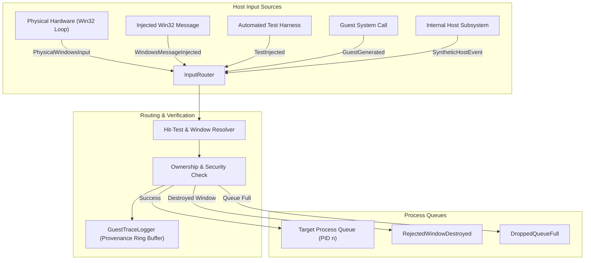

# WinIOS Campaign 216 — Input Provenance & Win32 Integration Report

## 1. Provenance Architecture & Telemetry Design
In Campaign 216, every input event passing through the WinIOS subsystem carries immutable provenance metadata tracking its exact origin and final delivery disposition.

---

## 2. Provenance Taxonomy & Status Codes

### 2.1 Provenance Classifications (`InputProvenance`)
- `PhysicalWindowsInput` (0): Genuine hardware mouse or keyboard event received via the native Win32 window message pump.
- `WindowsMessageInjected` (1): Synthetic Win32 message posted or sent via Windows APIs (`PostMessage`, `SendMessage`, `SendInput`).
- `TestInjected` (2): Injected directly by automated test suites into `DisplayWindow` or `InputRouter`.
- `GuestGenerated` (3): Synthetic event generated by a guest process via Category C IPC.
- `SyntheticHostEvent` (4): Internal host event generated for system lifecycle (e.g., focus change, timer tick, window blur).

### 2.2 Delivery Dispositions (`InputDeliveryStatus`)
- `Delivered` (0): Successfully validated, routed, and appended to the target process's input queue.
- `DroppedQueueFull` (1): The target queue reached maximum capacity; event dropped per backpressure policy.
- `RejectedNoTargetWindow` (2): Cursor hit testing failed to find any interactive window at the specified coordinates.
- `RejectedProcessMismatch` (3): Caller attempting to route to a window owned by another PID without authorization.
- `RejectedWindowDestroyed` (4): Target window was closed or destroyed prior to event dequeueing.
- `RejectedUnauthorized` (5): Process lacks `input.route` or target interaction capability.

---

## 3. Win32 Message Loop Processing & Scaling
- **Coordinate Scaling:** Maps arbitrary host client dimensions `(host_w, host_h)` to virtual display coordinates `(disp_w, disp_h)`:
  $$\text{scale}_x = \frac{\text{disp}_w}{\text{host}_w}, \quad \text{scale}_y = \frac{\text{disp}_h}{\text{host}_h}$$
- **Clamping:** Evaluated coordinates are clamped to $[0, \text{disp}_w - 1]$ and $[0, \text{disp}_h - 1]$ to guarantee memory safety.
- **Mouse Capture Lifecycle:** On `WM_LBUTTONDOWN`, mouse capture is acquired via `SetCapture(hwnd)`. Subsequent `WM_MOUSEMOVE` messages are routed exclusively to the captured window until `WM_LBUTTONUP` releases capture via `ReleaseCapture()`.
- **Keyboard Translation:** Virtual key codes (`VK_LEFT`, `VK_RIGHT`, `VK_RETURN`, etc.) are mapped alongside modifier state (Shift, Ctrl, Alt). `WM_CHAR` delivers UTF-32/ASCII character codes directly to active text views.
