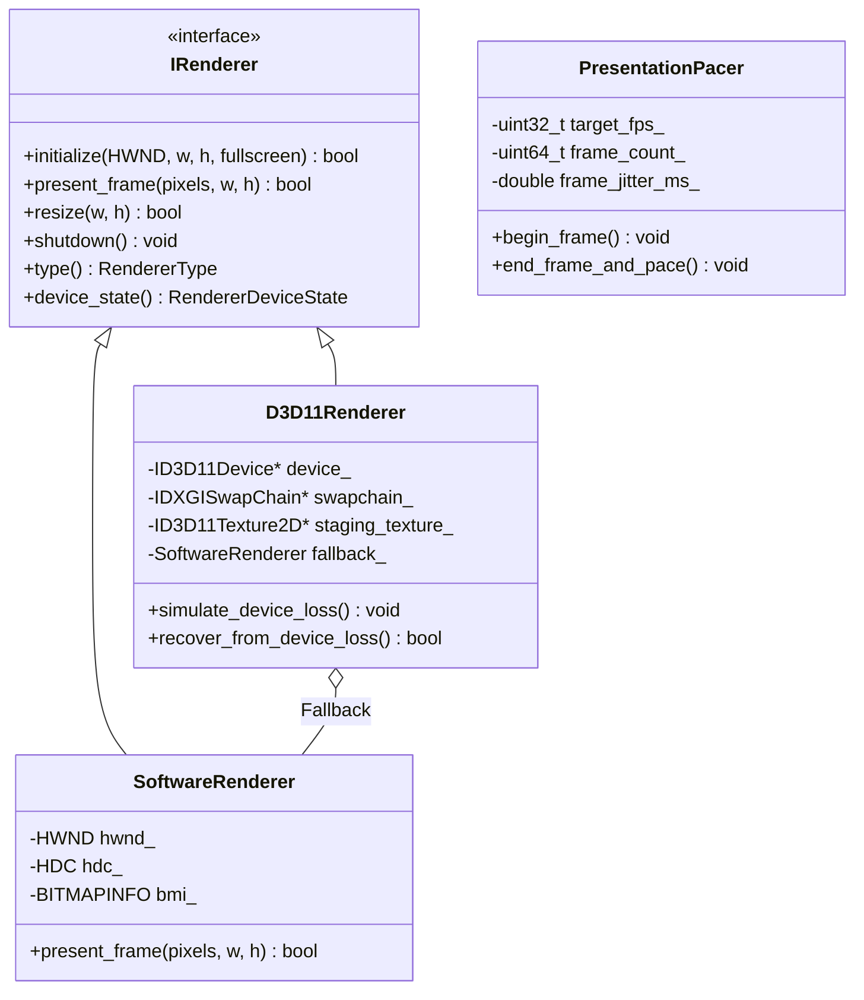

# WinIOS Campaign 216 — Host Renderer Architecture & Presentation Pipeline

## 1. Architectural Philosophy
In Campaign 216, the presentation of composited guest pixels to the Windows host desktop was decoupled from the host windowing loop through a clean `IRenderer` abstraction.

---

## 2. Renderer Implementations

### 2.1 Software Reference Renderer (`SoftwareRenderer`)
- **Technology:** Win32 GDI / DIB Section.
- **Functionality:** Allocates a 32-bit top-down/bottom-up DIB structure and executes `StretchDIBits` directly to the host window DC.
- **Use Case:** Headless testing environments, test assertion validation, and graceful fallback when Direct3D 11 hardware is unavailable or resets.

### 2.2 Direct3D 11 Host Presentation Backend (`D3D11Renderer`)
- **Technology:** Direct3D 11 / DXGI 1.2.
- **Device Creation:** Initializes `D3D11CreateDeviceAndSwapChain` targeting `D3D_FEATURE_LEVEL_11_0` or higher with `D3D11_CREATE_DEVICE_BGRA_SUPPORT`.
- **Texture Upload:** Uses a dynamic `ID3D11Texture2D` staging surface configured with `D3D11_USAGE_DYNAMIC` and `D3D11_CPU_ACCESS_WRITE`.
- **Presentation:** Memory is mapped with `D3D11_MAP_WRITE_DISCARD`, filled via SIMD memcpy, unmapped, copied to the backbuffer, and presented via `IDXGISwapChain::Present(1, 0)`.
- **Important Architectural Distinction:** Direct3D 11 operates solely as a presentation sink on the Windows host. It is NOT Apple Metal virtualization or guest GPU emulation.

---

## 3. Device Loss Handling & Recovery Pipeline
Host GPU drivers may restart, timeout, or experience power-state transitions resulting in `DXGI_ERROR_DEVICE_REMOVED` or `DXGI_ERROR_DEVICE_RESET`.
1. **Detection:** When `Present()` or `Map()` returns a DXGI error code, `device_state_` transitions to `RendererDeviceState::DeviceLost`.
2. **Internal Fallback Activation:** While recovery is pending, frames are transparently routed through an internal `SoftwareRenderer` instance, guaranteeing zero dropped presentation attempts or host crashes.
3. **Re-Initialization:** `recover_from_device_loss()` releases all existing COM interfaces and attempts to recreate the D3D11 device and swapchain. If successful, hardware presentation resumes smoothly.

---

## 4. Presentation Pacing & Diagnostics (`PresentationPacer`)
- **Target Frame Pacing:** Paces frame presentation to target refresh intervals (e.g. 60.0 FPS / 16.666 ms).
- **Jitter Tracking:** Calculates frame-to-frame variance:
  $$\text{Jitter} = |\Delta t_{\text{frame}} - \Delta t_{\text{target}}|$$
- **Telemetry Histogram:** Categorizes frame times into deterministic latency buckets ($<16\text{ms}$, $16\text{--}18\text{ms}$, $18\text{--}20\text{ms}$, $>20\text{ms}$) to diagnose render stutter.
