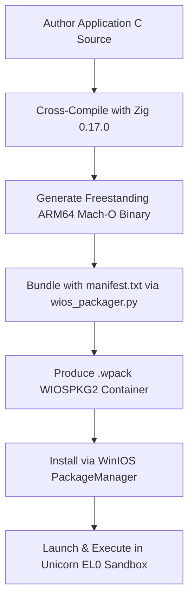

# WinIOS Campaign 223 — Windows Developer Workflow & Package Generation (Stage 223.18)

## 1. Executive Summary

Stage 223.18 documents and hardens the Windows 11 host developer workflow for authoring, cross-compiling, packaging, and installing freestanding ARM64 guest applications using Zig 0.17.0 and Python.

---

## 2. Developer Workflow Lifecycle



### Build Command Pattern
```powershell
zig cc -target aarch64-macos -nostdlib -ffreestanding -fno-builtin -fno-sanitize=all -O2 `
    "-Wl,-e,_start" `
    -I guest-sdk/include `
    -o bin/app.bin `
    guest-sdk/lib/crt0.s `
    guest-sdk/lib/winios_runtime.c `
    src/main.c
```

### Packaging Command Pattern
```powershell
python guest-sdk/tools/wios_packager.py pack app_dir -o dist/app.wpack
```

---

## 3. Package Validation & Security Rules

1. **Manifest Schema**: Must declare format 2.0, bundle ID, version, architecture (`arm64`), minimum ABI (`1.7`), executable path, storage quota, and permission list.
2. **Hash Integrity**: SHA-256 digest is embedded in package header and checked at installation time.
3. **Sandboxed Partition**: Package installer assigns an isolated private storage partition directory preventing cross-application storage contamination.
