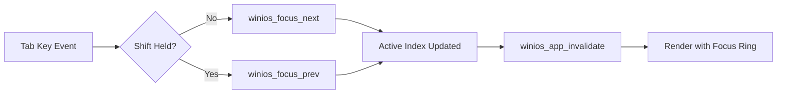

# WinIOS Campaign 223 — Keyboard Navigation & Focus System (Stage 223.8)

## 1. Overview

Stage 223.8 validates accessible, keyboard-driven UI interaction through the `winios_focus_manager_t`.

---

## 2. Implementation Specifications

1. **Focus Ring Rendering**: Active controls render an accent-colored border (e.g., Apple System Blue `0xFF007AFF`) indicating keyboard focus.
2. **Circular Navigation**: Tab at the end of the focus chain wraps cleanly to index 0; Shift-Tab wraps from 0 to `count - 1`.
3. **Registration Order**: Focus indices match registration order, allowing natural tab order according to visual reading order.

---

## 3. Verification

Validated in `tests/unit/stage223_7_ui_component_tests.cpp` (Test 4):
- Multiple controls registered.
- Forward Tab navigation cycles index 0 -> 1 -> 2 -> 0.
- Reverse Shift-Tab cycles index 0 -> 2 -> 1 -> 0.
- Verification: 100% PASS.
