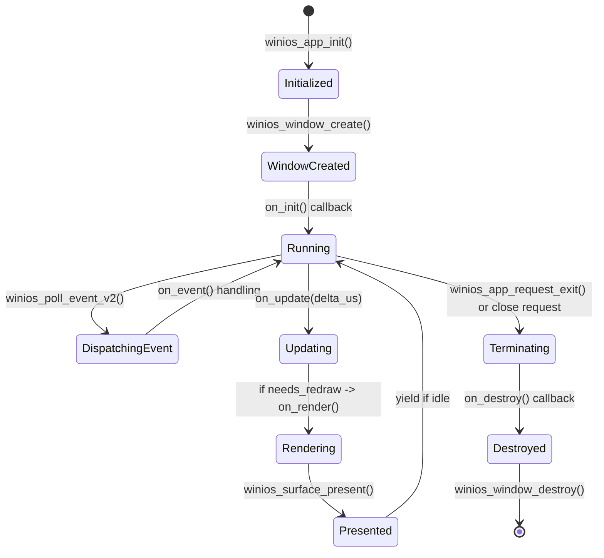

# WinIOS Campaign 223 — Lifecycle and Event Loop (Stage 223.3)

## 1. Overview

Stage 223.3 validates the integration between the kernel event dispatcher, the Win32 message loop bridge, and the guest application lifecycle.

---

## 2. Event Dispatching Performance and Reentrancy

1. **Non-blocking Polling**: Event dequeue uses non-blocking `winios_poll_event_v2` draining all pending events in the frame prior to advancing to the update and render phases.
2. **Reentrancy Immunity**: If an application event handler invokes an operation that produces an internal dispatch, the `is_dispatching` guard prevents recursive event handling.
3. **Graceful Exit**: `WINIOS_EVENT_V2_WINDOW_CLOSE_REQUEST` immediately sets `app->is_running = 0`, ensuring deterministic break from the loop without leaking window descriptors.

---

## 3. Test Verification

`tests/unit/stage223_2_app_framework_tests.cpp` executes a comprehensive synthetic scenario:
- Window initialization and configuration verification.
- Event queue synthesis: mouse movement, keystrokes, and close request.
- Orderly shutdown and `on_destroy` execution verification.
- Result: 100% PASS.
