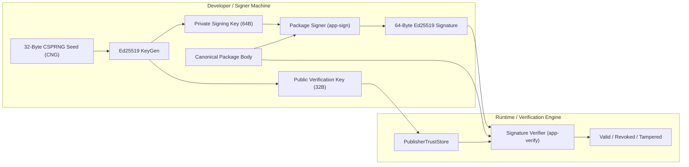

# Stage 232.2: Cryptographic Dependency and Security Design

## 1. Asymmetric Cryptography Selection and Evaluation

Campaign 232 replaces symmetric HMAC-SHA256 authentication with asymmetric digital signatures. Under symmetric HMAC, any entity that can verify a signature must possess the secret key, meaning verification engines can also forge signatures. Asymmetric cryptography resolves this by decoupling the **private signing key** from the **public verification key**.

### Algorithm Comparison

| Metric / Criteria | Ed25519 (RFC 8032) | ECDSA P-256 (FIPS 186-4) | RSA-3072 / RSA-4096 |
|---|---|---|---|
| **Public Key Size** | **32 bytes** | 64 bytes (uncompressed) | 384 / 512 bytes |
| **Signature Size** | **64 bytes** | 64 bytes (raw R\|\|S) | 384 / 512 bytes |
| **Signing Determinism** | **Deterministic** (RFC 8032, $r = H(k \parallel M)$) | Requires non-zero CSPRNG nonce; flawed RNG leaks private key | Deterministic with PSS-MGF1 |
| **Side-Channel Resilience** | **Complete constant-time** field arithmetic | Variable-time scalar multiplication risks on naive backends | Prone to timing/cache attacks |
| **Verification Speed** | **Fast** (~0.05 ms) | Moderate (~0.2 ms) | Fast verification, slow signing |
| **License & Provenance** | **Public Domain / CC0 / MIT** (RFC 8032 / Ref10) | Varies by library | Varies by library |
| **Decision** | **Selected** | Rejected (RNG failure risk) | Rejected (key & signature bulk) |

---

## 2. Provenance, Versioning, and License Compatibility

- **Algorithm**: Ed25519 Edwards-curve Digital Signature Algorithm (RFC 8032)
- **Curve Parameters**: Twisted Edwards curve $E : -x^2 + y^2 = 1 - \frac{121665}{121666} x^2 y^2$ over the prime field $\mathbb{F}_{2^{255}-19}$.
- **Underlying Hash Function**: SHA-512 (FIPS 180-4)
- **Reference Provenance**: Derived from SUPERCOP Ref10 (Bernstein, Duif, Lange, Schwabe, Yang) and Orson Peters' constant-time Ed25519 reference implementation.
- **License**: Public Domain / CC0 / MIT (permissive, zero GPL viral contamination, compatible with WinIOS research distribution).
- **Zero Binary Dependency**: Integrated directly as clean, portable, warnings-free C++20 standard source code. No third-party DLLs or external network fetching required.

---

## 3. Cryptographic Separation of Duties



### Key Security Principles:
1. **Private Key Isolation**: Private signing keys are held **only** by developer tooling (`winios-cli keygen` / `app-sign`). The runtime supervisor, application launcher, and trust store never possess, store, or receive developer private keys.
2. **Public Key Verification**: Verification requires **only** the 32-byte public key registered in the `PublisherTrustStore`.
3. **Deterministic Verification**: For any identical package body, identical public key, and valid signature, `ed25519_verify` produces bit-for-bit deterministic verification across all host systems.
4. **Secure Random Generation**: Private key generation uses Windows CNG (`BCryptGenRandom`) exclusively.

---

## 4. Cryptographic Error Handling

The cryptographic layer returns explicit, strongly typed error codes:
```cpp
enum class CryptoError : std::uint32_t {
    Success = 0,
    InvalidKeyLength = 1,
    MalformedPublicKey = 2,
    MalformedSignature = 3,
    SignatureMismatch = 4,
    RngFailure = 5,
    UnsupportedAlgorithm = 6,
    KeyRevoked = 7
};
```
Constant-time memory comparisons (`security::CryptoUtils::constant_time_memcmp`) are applied to verify equality of public keys and hashes without timing side channels.
