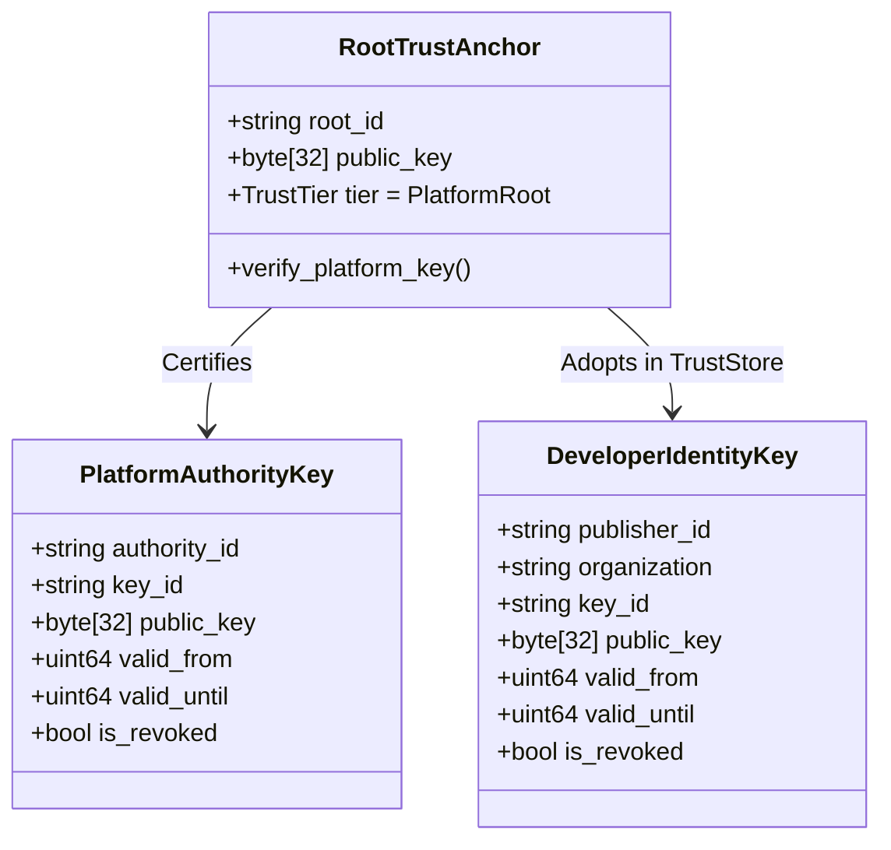
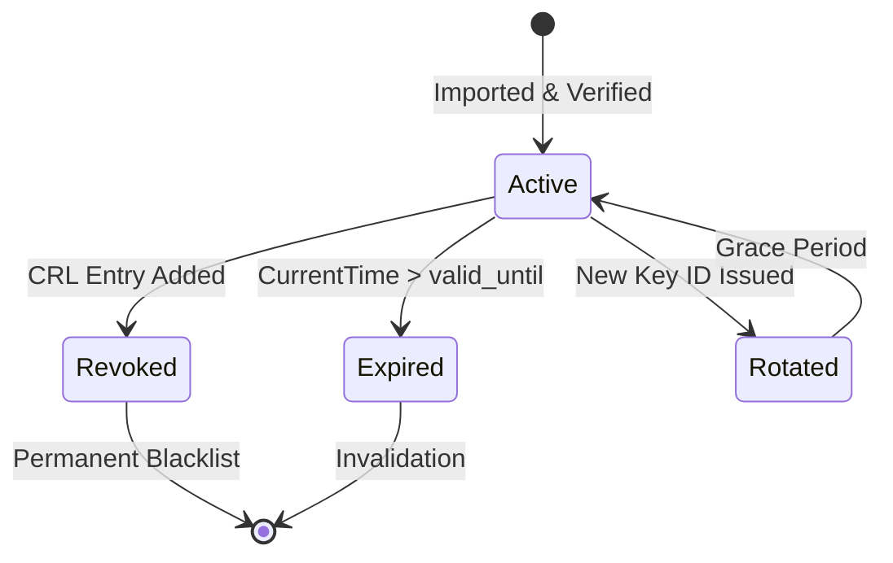

# Stage 232.3: Asymmetric Signature Architecture & Trust Hierarchy

## 1. Executive Summary

Stage 232.3 formalizes the asymmetric public-key signature architecture for WinIOS. The architecture replaces symmetric shared secrets with standard asymmetric public-key cryptography (Ed25519, RFC 8032), ensuring that application packages are signed exclusively by private key holders while runtime verification is performed strictly using certified public verification keys.

---

## 2. Key Hierarchy and Role Separation

### 1. Root Trust Anchor (`platform-root`)
- **Role**: Embedded, immutable platform trust anchor compiled into the runtime supervisor.
- **Payload**: Contains the official public key (`platform-root-key-01`) used to authenticate core platform packages, system daemons, and embedded workloads.
- **Key Storage**: Public key compiled directly into read-only binary text segment; private key kept offline.

### 2. Platform Signing Authority (`platform-authority`)
- **Role**: Active signing identity for official WinIOS system packages.
- **Entitlements**: Entitled to system-level permissions (`SystemServices`, `DirectHardwareAccess`, `RawKernelMemory`).

### 3. Developer Signing Identities (`developer-identity`)
- **Role**: Independent third-party developer organizations (e.g., `dev.developer.alpha`, `org.openresearch.winios`).
- **Private Key**: Held securely on developer workstations in protected developer keystores (`%USERPROFILE%\.winios\keys\developer.key`). **The runtime supervisor never holds this key.**
- **Public Key**: Exported as public key certificates (`developer.pub`) and registered into the target machine's `PublisherTrustStore`.
- **Entitlements**: Restricted to sandboxed guest capabilities (`WindowServerAccess`, `DocumentPickerAccess`, `AudioCapture`).

---

## 3. Cryptographic Separation of Concepts

It is crucial to distinguish between four distinct security guarantees:

| Security Property | Definition | Underlying Cryptographic Mechanism | Observed Guarantee |
|---|---|---|---|
| **Content Integrity** | Verifying that the package files have not been modified or corrupted in transit. | SHA-256 Per-File Digests in `WIOSPKG3` File Table | Detects accidental file truncation, bit flips, or transmission corruption. Does **not** prove who created it. |
| **Publisher Authenticity** | Proving that the package was signed by the specific holder of a recognized private key. | Ed25519 Digital Signature (`WIOSAUTH v2`) verified with Publisher Public Key | Non-repudiation: guarantees that only the holder of the matching private key could have produced the signature. |
| **Authorization** | Determining whether the publisher is permitted to request specific system capabilities. | Entitlement resolution in `PackageManifest` mapped against Publisher Role | Policy enforcement: ensures developer packages cannot acquire platform-level supervisor rights. |
| **Trust-Chain Validation** | Verifying that the public key is recognized, within its valid time window, and not revoked. | `PublisherTrustStore` status queries and dynamic CRL lookup | Lifecycle enforcement: prevents execution of packages signed by compromised or revoked keys. |

---

## 4. Key Lifecycle States and Revocation Semantics

Each key registered in the `PublisherTrustStore` transitions through formal lifecycle states:

- **Active**: Key is valid, unrevoked, and within `[valid_from, valid_until]`. Signatures pass verification.
- **Revoked**: Key ID or Publisher ID exists in the revocation blacklist. Verification returns `SignatureStatus::RevokedPublisher` unconditionally.
- **Expired**: Current timestamp exceeds `valid_until`. Verification returns `SignatureStatus::ExpiredSignature`.
- **Rotated**: Publisher introduces a new key identifier (`key_id_v2`). Packages signed with the retired key continue to verify until expiration unless explicitly revoked.
