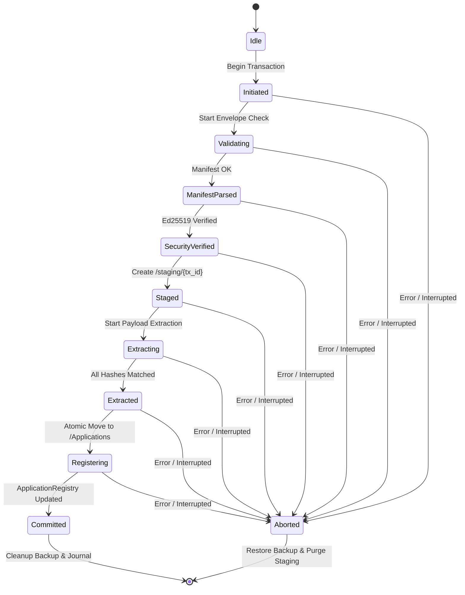

# WinIOS Campaign 233 — Stage 233.12 Deliverable
## Write-Ahead Log (WAL) Package Installer 11-State Machine Specification

### 1. Executive Summary & Purpose
Stage 233.12 formally documents the 11-state Write-Ahead Log (WAL) transaction engine of `PackageInstaller` (`src/packaging/package_installer.h`, `src/packaging/package_installer.cpp`).
The WAL guarantees atomic, durable, and crash-resilient package installations and updates across host process crashes, sudden power interruptions, and filesystem errors.

---

### 2. State Machine Specification



#### Detailed State Definitions

| State # | State Name | Action / Invariant Maintained | Rollback Action on Crash |
| :---: | :--- | :--- | :--- |
| **0** | `Idle` | No active transaction in progress. | No-op. |
| **1** | `Initiated` | Fresh transaction ID (`tx_id`) generated; journal initialized. | Clean up transaction context. |
| **2** | `Validating` | Header magic, version, and container bounds checked. | Clean up transaction context. |
| **3** | `ManifestParsed` | Package manifest deserialized; permissions and architecture verified. | Clean up transaction context. |
| **4** | `SecurityVerified`| WIOSAUTH v2 signature verified against `PublisherTrustStore`. | Clean up transaction context. |
| **5** | `Staged` | Isolated staging directory `/staging/<tx_id>` created with journal. | Remove `/staging/<tx_id>`. |
| **6** | `Extracting` | File entries extracted to `/staging/<tx_id>/bundle`. | Remove `/staging/<tx_id>`. |
| **7** | `Extracted` | SHA-256 digests of all extracted files verified against manifest. | Remove `/staging/<tx_id>`. |
| **8** | `Registering` | For updates: existing `/Applications/<id>` moved to `/backup/<id>`. Staging moved to `/Applications/<id>`. | Move `/backup/<id>` back to `/Applications/<id>`; purge staging. |
| **9** | `Committed` | Registry record updated in `ApplicationRegistry`. Final commit point. | Finalize registry entry; delete backup and staging. |
| **10** | `Aborted` | Terminal state for canceled or failed transactions. | Staging purged; original state intact. |

---

### 3. WAL Journal Architecture (`journal.json`)

At every state transition, the installer synchronously updates `/staging/<tx_id>/journal.json`:

```json
{
  "transaction_id": "tx-8f4b29c1",
  "bundle_id": "com.developer.app",
  "state": "Extracted",
  "is_update": true,
  "target_dir": "/Applications/com.developer.app",
  "backup_dir": "/staging/tx-8f4b29c1/backup",
  "checksum": "e3b0c44298fc1c149afbf4c8996fb92427ae41e4649b934ca495991b7852b855"
}
```

The `checksum` is computed over `tx_id | bundle_id | state | is_update | target_dir | backup_dir`, preventing journal tampering or partial disk writes from confusing the recovery engine.

---

### 4. Crash Recovery Protocol (`reconcile_and_recover`)

On WinIOS boot or installer initialization:
1. Scan `/staging` for any directories containing `journal.json`.
2. Parse and verify journal checksum:
   - If corrupted or incomplete, purge the staging folder.
3. Check recorded transaction state:
   - If state $\in \{ \text{Initiated}, \dots, \text{Registering} \}$:
     - If `is_update == true` and `backup_dir` exists, restore `backup_dir` to `target_dir`.
     - Remove `/staging/<tx_id>`.
     - Log recovery event: `abandoned_transactions_cleaned++` or `backups_restored++`.
   - If state $== \text{Committed}$:
     - Ensure `ApplicationRegistry` has recorded the installation.
     - Delete `backup_dir` and remove `/staging/<tx_id>`.
     - Log recovery event: `committed_transactions_finalized++`.
4. Result: Zero orphaned files, zero partial extractions, zero application downtime.
