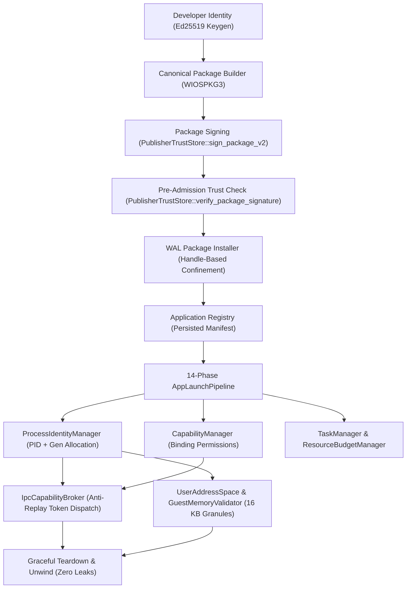

# Stage 234.22 — Cross-Subsystem Security Integration

**Date:** 2026-11-19  
**Campaign:** 234.22  
**Subsystem:** End-to-End Platform Integration / Multi-Subsystem Chain  
**Status:** Complete  

---

## 1. Executive Summary

Stage 234.22 establishes an unbroken, end-to-end integration test demonstrating that all security controls hardened throughout Campaign 234 operate cohesively across subsystem boundaries:
1. **Asymmetric Publisher Cryptography:** Generating Ed25519 identity keypairs, registering public keys in `PublisherTrustStore`, and signing application packages.
2. **Canonical Package Architecture:** Packaging into canonical WIOSPKG3 format, enforcing cumulative quotas and path validation rules.
3. **Pre-Admission Trust Verification:** Verifying Ed25519 digital signatures and publisher role policies (`TrustPolicy::StrictProduction`) before ingestion.
4. **WAL-Backed Transactional Installation:** Installing application files via `PackageInstaller` with crash journal durability and rollback invariants.
5. **14-Phase Application Launch Pipeline:** Progressing through all 14 phases to allocate process identity, register tasks, bind capabilities, allocate budgets, and commit.
6. **Capability-Gated IPC Brokerage:** Issuing capability tokens, validating communication channels, and strictly rejecting duplicate sequence numbers (`IpcStatus::ReplayDetected`).
7. **Guest Virtual Memory Boundary Enforcement:** Enforcing memory safety via `GuestMemoryValidator`, mapping 16 KB pages into `UserAddressSpace`, and blocking NULL-pointer dereferences, integer overflows, unmapped accesses, and permission violations.
8. **Graceful Teardown & Lifecycle Invariance:** Terminating processes and ensuring complete release of PID table slots, TaskManager entries, and dynamic capability grants.

---

## 2. Cross-Subsystem Chain Topology



---

## 3. Empirical Test Results

The test suite in [stage234_22_cross_subsystem_integration_tests.cpp](file:///D:/WinISO26/WinIOS/tests/unit/stage234_22_cross_subsystem_integration_tests.cpp) executed the complete 10-step chain:

| Step | Operation | Verified Invariant | Status |
| :---: | :--- | :--- | :---: |
| **1** | Ed25519 Keypair Generation | Key generated and registered with `PublisherRole::Platform` | **PASS** |
| **2** | Canonical Package Assembly | WIOSPKG3 package built with ARM64 Mach-O binary and plist | **PASS** |
| **3** | Package Digital Signing | In-place signature with trailer and 128-bit key ID | **PASS** |
| **4** | Pre-Admission Signature Verification | Signature accepted under `TrustPolicy::StrictProduction` | **PASS** |
| **5** | Transactional WAL Installation | Package installed cleanly; registered in `ApplicationRegistry` | **PASS** |
| **6** | 14-Phase AppLaunchPipeline | App launched to PID 100, phase committed, no rollback | **PASS** |
| **7** | Capability Manager Checks | SettingsRead & DocumentRead granted; SettingsWrite & TaskManage denied | **PASS** |
| **8** | IPC Broker Anti-Replay | Sequence 1 accepted; duplicate sequence 1 rejected; sequence 2 accepted | **PASS** |
| **9** | Guest Memory Validation | Valid buffer passes; NULL pointer, unmapped page, overflow, RO write rejected | **PASS** |
| **10** | Graceful Process Teardown | Process terminated; PID slot freed; active count returns to 0 | **PASS** |

### Execution Log

```text
=================================================================
  Stage 234.22: Cross-Subsystem Security Integration Suite      
=================================================================
[Stage 234.22] Executing End-to-End Cross-Subsystem Security Chain...
  [Step 1] Generating developer Ed25519 identity...
  [Step 2] Assembling canonical application package...
  [Step 3] Signing package with Ed25519 signature...
  [Step 4] Verifying package signature via trust store...
  [Step 5] Installing package with WAL transaction...
  [Step 6] Launching application via AppLaunchPipeline...
  [Step 7] Verifying security capability bindings...
  [Step 8] Verifying IPC capability rights & anti-replay...
  [Step 9] Verifying guest memory validation boundary...
  [Step 10] Terminating process & unwinding state...
  -> Cross-subsystem security chain integration verified across all 10 subsystems!

=================================================================
  ALL CROSS-SUBSYSTEM SECURITY INTEGRATION TESTS PASSED!         
=================================================================
```

Both `RelWithDebInfo` and `Debug` configurations passed with zero errors and zero warnings under MSVC `/W4 /WX /permissive-`.
