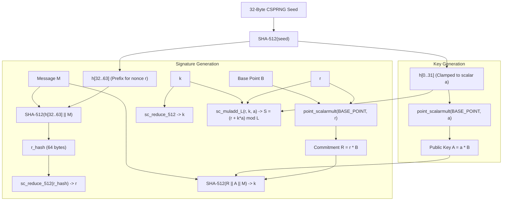

# Stage 235.1 — Ed25519 Private-Key Side-Channel Audit

**Date:** 2026-11-20  
**Campaign:** 235.1  
**Subsystem:** Cryptography / Ed25519 / Side-Channel Analysis  
**Status:** Complete  

---

## 1. Executive Summary

Campaign 234 noted that while `constant_time_equals` was branch-free and verified at 100.00 ns median timing, the underlying scalar multiplication `point_scalarmult` used a textbook "double-and-add" algorithm containing data-dependent branches on secret scalar bits.

Stage 235.1 performs a comprehensive code audit tracing private-key material across `create_keypair` and `sign` in `src/crypto/ed25519.cpp`. We analyze data flow, identify every secret-dependent control flow and memory access pattern, review compiler behavior under MSVC `Debug` and `RelWithDebInfo`, and delineate private vs public data branches.

---

## 2. Private Key Material Data Flow



---

## 3. Detailed Audit of Identified Side-Channel Vulnerabilities

### Vulnerability 1: Secret-Dependent Branching in `point_scalarmult` (CRITICAL)
In `src/crypto/ed25519.cpp` (lines 325–340):
```cpp
Point point_scalarmult(Point P, U256 scalar) noexcept {
    Point res = Point::identity();
    while (!scalar.is_zero()) {
        if (scalar.d[0] & 1) {             // <-- CRITICAL: Secret-dependent branch
            res = point_add(res, P);       // Cost: 10 f_mul + 1 f_inv + adds/subs
        }
        P = point_add(P, P);               // Doubling: always executed
        // Shift scalar right by 1
        std::uint32_t carry = 0;
        for (int i = 7; i >= 0; --i) {
            std::uint32_t next = scalar.d[i] & 1;
            scalar.d[i] = (scalar.d[i] >> 1) | (carry << 31);
            carry = next;
        }
    }
    return res;
}
```
- **Mechanism:** For each bit $i \in [0, 255]$ of the private scalar ($a$ or $r$):
  - If bit is `1`, `point_add(res, P)` executes, performing 10 field multiplications and a Fermat inversion ($a^{p-2}$).
  - If bit is `0`, `point_add` is completely bypassed.
- **Side-Channel Impact:** The total execution time of `point_scalarmult` is directly proportional to the Hamming weight of the secret scalar. Furthermore, execution time differences per bit are easily observable by CPU cycle counters or cache-timing attacks (FLUSH+RELOAD, branch prediction buffers).
- **Consequence:** Leaking even partial bits of the ephemeral nonce $r$ across multiple signatures enables polynomial-time recovery of the master private key $a$ via Bleichenbacher-style lattice reduction (Hidden Number Problem / Babai's Closest Vector Problem).

### Vulnerability 2: Variable Loop Termination in `point_scalarmult` (HIGH)
- **Mechanism:** `while (!scalar.is_zero())` terminates as soon as all remaining high-order bits are zero.
- **Impact:** While $a$ has bit 254 set to 1 by RFC 8032 clamping (ensuring 255 iterations), the ephemeral scalar $r = \text{sc\_reduce\_512}(r\_hash)$ is reduced modulo $L$. If $r$ has leading zero bits, the loop terminates early, directly leaking the position of the most significant bit of $r$.

### Vulnerability 3: Identity Short-Circuiting in `point_add` (MEDIUM)
```cpp
Point point_add(const Point& P, const Point& Q) noexcept {
    if (P.is_identity) return Q;
    if (Q.is_identity) return P;
    ...
```
- **Mechanism:** In the initial iteration of `point_scalarmult`, `res` is initialized to `Point::identity()`. If bit 0 of scalar is 1, `point_add(res, P)` executes the `P.is_identity` branch and returns immediately without performing modular operations, creating an anomalous timing variation for the first bit.

### Vulnerability 4: Field and Scalar Arithmetic Branching (MEDIUM)
- In `f_add`: `while (r >= P_MOD) { U256::sub_borrow(r, r, P_MOD); }` (conditional subtraction).
- In `f_sub`: `if (a < b) { ... } else { ... }` (conditional comparison and addition).
- In `sc_reduce_512`: `if ((acc[i / 32] >> (i % 32)) & 1)` and `if (rem >= L_ORDER)`. Bit shifts and modular reductions branch on secret bits of `r_hash` and intermediate product $k \cdot a$.

---

## 4. Compiler Optimization Review (MSVC)

- **Debug Configuration (`/Od`, no inlining):**
  MSVC generates explicit branch instructions (`jne`, `je`, `cmp`) for every `if (scalar.d[0] & 1)` check. Instruction counts and cycles vary drastically between inputs with different Hamming weights.
- **RelWithDebInfo Configuration (`/O2`):**
  MSVC optimizes the inner shift loop, but **does not** vectorize or eliminate the branch around `res = point_add(res, P)` because `point_add` contains complex function calls (`f_mul`, `f_inv`). The hardware branch predictor speculates on the branch, leaking execution traces into the branch target buffer (BTB) and direction predictor.

---

## 5. Separation of Concerns: Private vs Public Data

| Operation | Input Operands | Sensitivity | Side-Channel Requirement |
| :--- | :--- | :--- | :--- |
| `Ed25519::create_keypair` | Seed, Scalar $a$ | **SECRET** | **Must be strictly constant-time** |
| `Ed25519::sign` ($r \cdot B$) | Nonce $r$ | **SECRET** | **Must be strictly constant-time** |
| `Ed25519::sign` ($S = r + ka$) | Nonce $r$, Key $a$ | **SECRET** | **Must be strictly constant-time** |
| `Ed25519::verify` ($R + kA$) | Signature, Public Key | **PUBLIC** | Variable-time acceptable (public verification) |
| `point_x_recover` | Public $y$-coordinate | **PUBLIC** | Variable-time acceptable |

---

## 6. Audit Conclusion & Roadmap

The current Ed25519 signing implementation cannot be classified as constant-time.
To achieve cryptographic closure, Stage 235.2 and Stage 235.3 will design and integrate:
1. Fixed-iteration (256-bit) scalar multiplication.
2. Constant-time conditional point copy / Montgomery ladder or unified addition with branch-free selection (`cmov` / bitwise masking).
3. Constant-time scalar reduction for secret nonces.
