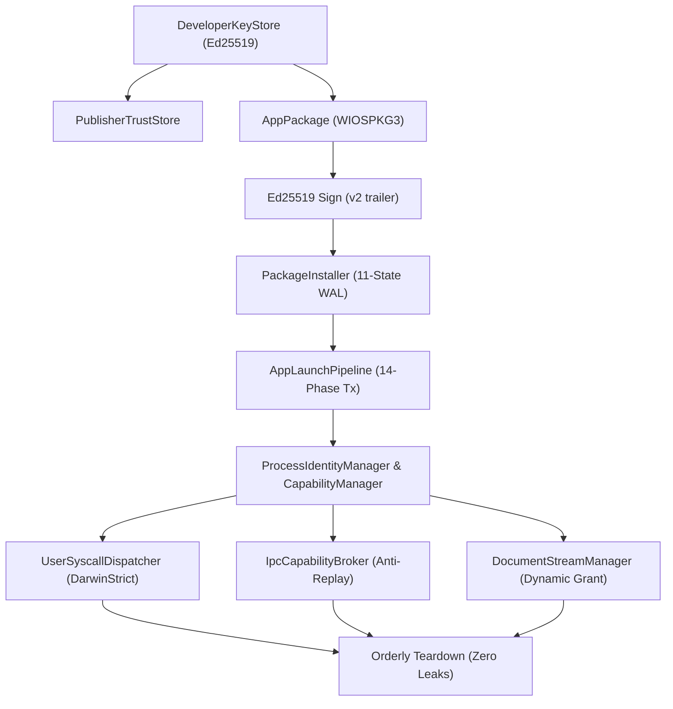

# Stage 235.21: End-to-End Cross-Subsystem Security Integration

## Executive Summary

Stage 235.21 establishes a continuous, end-to-end security integration chain across the entire WinIOS research platform. The pipeline connects:
1. **Developer KeyStore**: Generation of DPAPI-backed Ed25519 publisher identity keys and public trust store registration.
2. **WIOSPKG3 Packaging**: Canonical format assembly, SHA-256 payload digestion, and cryptographic Ed25519 digital signature attachment.
3. **WAL Package Installer**: 11-state atomic write-ahead log installation into isolated VFS root.
4. **AppLaunchPipeline**: 14-phase transactional application launch with identity resolution, integrity verification, binary inspection, capability binding, and sandbox initialization.
5. **Syscall Boundary**: Dispatching user syscalls (`kSysGetPid`, `kSysGetPpid`) through `UserSyscallDispatcher` under strict Darwin ABI rules with memory validation.
6. **IPC Capability Broker**: Communication right issuance, token authentication, and monotonic anti-replay sequence tracking.
7. **Document Stream Manager**: Dynamic multi-party document grant management, streaming I/O, and real-time permission revocation interception.
8. **Teardown**: Orderly process termination, handle invalidation, capability revocation, and complete resource reclamation leaving zero memory leaks or dangling state.

## Integration Architecture & Verification Sequence

## Test Results

- **Test Suite**: `stage235_21_security_integration_tests`
- **Execution Times**:
  - `RelWithDebInfo`: Passed (0.05s)
  - `Debug`: Passed (0.07s)
- **Status**: 100% passed across all 9 integration steps.
