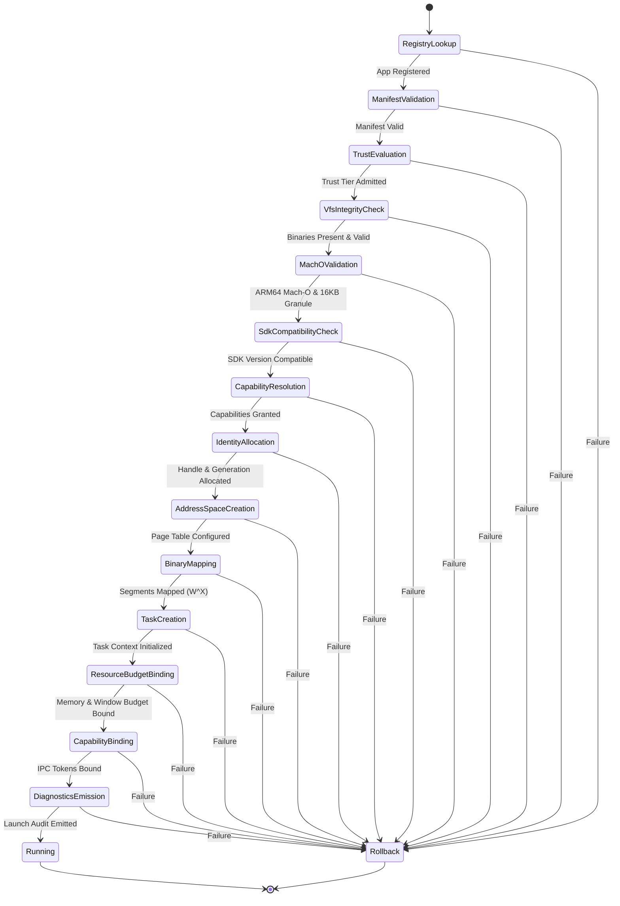

# WinIOS 14-Phase Application Launch Transaction Model

## 1. Architecture and State Machine

Launching a guest application in WinIOS is managed as an atomic, transactional state machine. If an error occurs at any phase of launch, the transaction is rolled back completely, leaving zero leaked tasks, zero allocated memory pages, zero orphaned IPC capabilities, and zero dangling process handles.

---

## 2. The 14 Sequential Launch Phases

| Phase # | Phase Identifier | Subsystem | Actions & Invariant Guarantees |
|---|---|---|---|
| **1** | `RegistryLookup` | `ApplicationRegistry` | Verify application bundle ID exists and installation state is `Installed`. |
| **2** | `ManifestValidation` | `PackageManifest` | Parse and validate manifest format, bundle name, executable path, and SDK version. |
| **3** | `TrustEvaluation` | `PublisherTrustStore` | Verify publisher signature, check revocation list, and enforce policy tier. |
| **4** | `VfsIntegrityCheck` | `VfsService` | Verify binary files exist in sandbox and file sizes match package manifest. |
| **5** | `MachOValidation` | `AppInspector` | Inspect Mach-O 64-bit headers (`MH_MAGIC_64`), CPU architecture (`CPU_TYPE_ARM64`), 16 KB page alignment, and W^X cleanliness. |
| **6** | `SdkCompatibilityCheck` | `SdkCompatGate` | Compare application target SDK version with platform host SDK ceiling (`0x00020400`). |
| **7** | `CapabilityResolution` | `CapabilityManager` | Resolve requested entitlements (Network, Documents, Camera, Audio) against manifest permissions. |
| **8** | `IdentityAllocation` | `ProcessIdentityManager` | Allocate monotonic generation handle `(pid, generation)` and 128-bit CSPRNG instance token. |
| **9** | `AddressSpaceCreation` | `PhysicalPageManager` | Instantiate isolated `UserAddressSpace` with zeroed top-level page tables. |
| **10** | `BinaryMapping` | `MachOLoader` | Map code (`__TEXT`) as `RX`, data (`__DATA`) as `RW`, zero out `BSS`, and configure stack. |
| **11** | `TaskCreation` | `TaskManager` | Create guest task context, set initial PC to Mach-O entry point, and setup SP. |
| **12** | `ResourceBudgetBinding` | `ResourceBudgetManager` | Bind per-process memory ceiling (16 MB), window limits (8), and file stream limits (16). |
| **13** | `CapabilityBinding` | `IpcCapabilityBroker` | Bind IPC endpoints and granted capabilities to the allocated generational process handle. |
| **14** | `DiagnosticsEmission` | `DiagnosticsService` | Record `ProcessLaunched` event with timestamp, PID, generation, bundle ID, and capability bitmask. |

---

## 3. Rollback Semantics and Error Recovery

If any phase encounters an error:
1. **Reverse Tear-down**: Subsystems are unwound in reverse order of allocation:
   - Capability bindings and IPC queues are cleared.
   - Resource budget allocations are restored to 0.
   - Task context is deleted from the scheduler.
   - Address space physical pages are released back to the page pool.
   - Generational process handle is terminated and slot quarantined.
2. **Crash Consistency**: The registry and filesystem state remain unchanged; partial installations or aborted launches never leave orphaned runtime artifacts.
3. **Audit Trail**: A diagnostic `LaunchFailed` entry is logged with the exact failure phase and error code.
