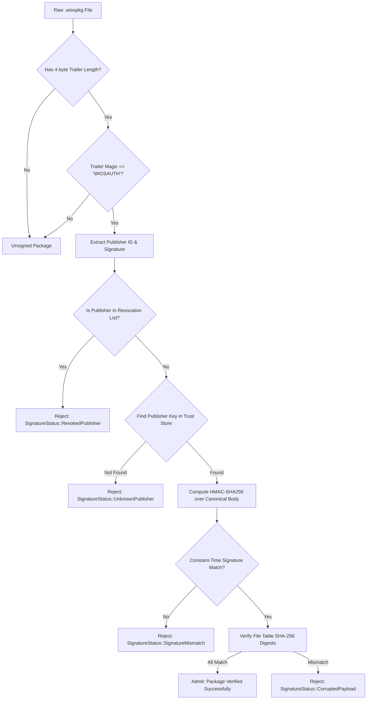

# WIOSPKG3 Digital Signatures and Publisher Trust Store Specification

## 1. Executive Summary

Campaign 231 introduces cryptographic package authenticity, publisher key management, and digital signature verification for WinIOS Application Packages (`.wiospkg`). The specification defines:
1. Canonical `WIOSPKG3` binary container structure.
2. Authenticated trailer format (`WIOSAUTH`).
3. Publisher Trust Store with hierarchical key rings and dynamic revocation lists.
4. Deterministic packaging algorithms ensuring bit-identical outputs.

---

## 2. Container Layout and Binary Architecture

A signed WinIOS package consists of the canonical `WIOSPKG3` body followed by an authenticated signature trailer:

```text
+=============================================================================+
|                      CANONICAL WIOSPKG3 CONTAINER BODY                      |
+-----------------------------------------------------------------------------+
| Header: "WIOSPKG3" (8 bytes: 0x57, 0x49, 0x4F, 0x53, 0x50, 0x4B, 0x47, 0x33)|
| Format Version: uint32_t (4 bytes, Little-Endian = 0x00000003)              |
| Manifest Byte Length: uint32_t (4 bytes, Little-Endian)                     |
| UTF-8 INI Manifest Payload                                                  |
| File Entry Count: uint32_t (4 bytes, Little-Endian)                         |
| File Table Entries:                                                         |
|   - Path Length (uint16_t) + Relative VFS Path String (canonical ASCII/UTF-8)|
|   - Data Size (uint64_t, Little-Endian)                                     |
|   - SHA-256 Digest (32 raw bytes)                                           |
| Concatenated Raw File Payloads (ordered canonically by path)                |
+=============================================================================+
|                      AUTHENTICATED TRAILER (WIOSAUTH)                       |
+-----------------------------------------------------------------------------+
| Trailer Magic: "WIOSAUTH" (8 bytes: 0x57, 0x49, 0x4F, 0x53, 0x41, 0x55, ...) |
| Trailer Version: uint32_t (4 bytes = 0x00000001)                            |
| Signature Type: uint16_t (2 bytes: 0x0001 = HMAC-SHA256)                    |
| Reserved Flags: uint16_t (2 bytes: 0x0000)                                  |
| Publisher ID Length: uint16_t (2 bytes)                                     |
| Publisher ID String (UTF-8, e.g., "platform-root", "dev-team-alpha")        |
| HMAC-SHA256 Signature (32 raw bytes)                                        |
| Trailer Length: uint32_t (4 bytes, Little-Endian)                           |
+=============================================================================+
```

---

## 3. Publisher Trust Store & Key Hierarchy

The `PublisherTrustStore` manages authorized public keys and HMAC verification secrets.

### Key Types
1. **Platform Root Key**: Embedded platform key used to sign built-in system applications and system services.
2. **Developer Certificate Keys**: Trusted third-party keys with developer entitlement grants.
3. **Revoked Keys**: Blacklisted keys whose signatures are rejected unconditionally (`SignatureStatus::RevokedPublisher`).

### Trust Policies
- **Strict (Production Profile)**: Rejects unsigned packages, unknown publishers, and revoked keys. Only valid Platform or Developer signatures are admitted.
- **Development**: Admits Platform and Developer signed packages. Unsigned packages may be admitted with restricted sandbox capabilities if policy allows.

---

## 4. Verification Workflow



---

## 5. Constant-Time Cryptographic Verification

To prevent timing side-channel attacks against HMAC comparison, signature verification uses `security::CryptoUtils::constant_time_memcmp`. Comparison time is independent of the number of matching leading bytes.
