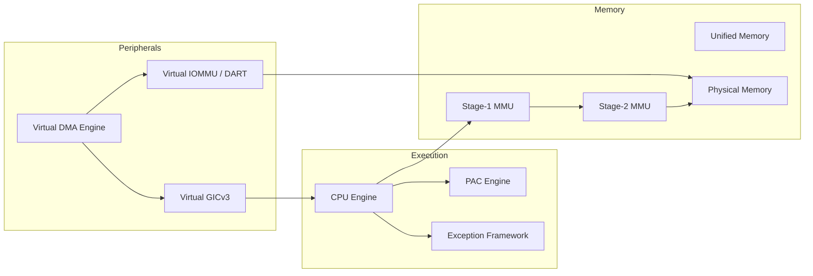

# WinIOS Campaign 200: Architecture and Dependency Audit

**Scope:** In-Depth Subsystem and Cross-Subsystem Architectural Audit  
**Target:** iPhone 15 (`iPhone15,4` / `D37AP` / Apple A16 Bionic `T8120`) Virtual Platform  
**Stage:** 200.1  
**Status:** COMPLETE  

---

## 1. Architectural Component Inventory

### 1.1 CPU Execution Engine (`src/cpu/cpu.h/cpp`)
- **Role:** Central AArch64 execution engine executing guest instructions, handling privilege transitions (EL0, EL1, EL2), updating architectural state, and routing exceptions.
- **Dependencies:** `mmu::MMU`, `Memory`, `winios::cpu::Arm64ePointerAuth`, `winios::cpu::SystemRegisters`.
- **State Model:** Register files (`X0`..`X30`, `SP_EL0`, `SP_EL1`, `SP_EL2`, `PC`, `PSTATE`, `V0`..`V31`), system registers, exception control state.
- **Finding:** Cleanly decoupled from host runtime; exceptions are strictly trapped via `SynchronousExceptionSignal` or architectural vectors without crashing the host process.

### 1.2 Memory Translation Hierarchy (Stage 1 & Stage 2 MMU)
- **Role:** Two-stage address translation pipeline:
  - **Stage 1 (`src/cpu/mmu.h/cpp`):** Translates Virtual Address (VA) to Intermediate Physical Address (IPA) using TTBR0/TTBR1 and TCR_EL1.
  - **Stage 2 (`src/memory/stage2_mmu.h/cpp`):** Translates IPA to Physical Address (PA) using VTTBR_EL2 and VTCR_EL2.
- **Combined Translation Pipeline:** Integrated in `MMU::walk_stage2` and `MMU::translate_combined`.
- **Finding:**
  - S1 table descriptors themselves reside in IPA space when Stage 2 is enabled.
  - Permission intersection is strictly evaluated: Effective access is `(S1_Read && S2_Read)`, `(S1_Write && S2_Write)`, and `(S1_Exec && S2_Exec)`.

### 1.3 Virtual IOMMU & DMA Engine (`src/device/`)
- **Role:** Peripheral address isolation modeled after Apple DART:
  - `VirtualIommu` manages isolated `IommuDomain` contexts.
  - `VirtualDmaEngine` executes descriptor-based transfers after translating `src_iova` and `dst_iova` through the device's attached domain.
- **Dependencies:** `VirtualIommu`, `SMPCluster` (for exclusive monitor clearing), `GICv3` (for interrupt signaling).
- **Finding:** `VirtualIommu` utilizes `std::recursive_mutex`, ensuring re-entrant thread safety during DMA descriptor processing and snapshot restoration.

### 1.4 ARM64e Pointer Authentication (PAC) Subsystem
- **Role:** Hardware cryptographic authentication engine supporting 5 128-bit keys:
  - `APIAKey`, `APIBKey`, `APDAKey`, `APDBKey`, `APGAKey`.
- **Instruction Coverage:** `PACIA/B`, `PACDA/B`, `AUTIA/B`, `AUTDA/B`, `PACIZA/B`, `PACDZA/B`, `AUTIZA/B`, `AUTDZA/B`, `XPACI/D`, `PACGA`, `BRAA/B`, `BLRAA/B`, `RETAA/B`.
- **Finding:**
  - System registers (`APIAKeyLo_EL1`..`APGAKeyHi_EL1`) are gated at EL1/EL2; access at EL0 triggers Undefined Instruction exception (`EC = 0x00`).
  - Authentication failure delivers synchronous exception `EC = 0x1C` (`kPacTrap`) when in `TrapException` mode, or injects bit 62 when in `CorruptUpperBits` mode.

### 1.5 Interrupt Architecture (Virtual GICv3)
- **Role:** Multi-core interrupt distributor and redistributor network:
  - Distributor at `0x08000000` (SPIs).
  - Per-core Redistributor at `0x080A0000 + core * 0x20000` (SGIs, PPIs).
  - EL2 List Registers (`ICH_LR_EL2`) for hypervisor virtual interrupt injection.
  - `GICD_IROUTER` affinity routing for target core steering.
- **Finding:** Clean separation between Distributor and Redistributor state; priority filtering via `ICC_PMR_EL1` functions as specified in ARM GICv3 architecture.

### 1.6 Device Tree & Platform Handoff
- **Role:** Dual device tree synthesis:
  - Canonical Apple DeviceTree (`src/device/apple_devicetree.cpp`): 6-core Everest/Sawtooth topology with PMGR, DISP0, ANS2, DART, and virtual DMA.
  - Flattened Device Tree (`src/device/fdt_builder.cpp`): SMMUv3 and Hypervisor nodes.
- **Finding:** `SyntheticKernelBootInfo` validates 16KB alignment and sets up initial register state (`X0 = DTB PA`, `PSTATE.EL = EL1`) conforming to Darwin/ARM64 boot specifications.

---

## 2. Dependency & Coupling Analysis

---

## 3. Potential Risks & Action Items for Campaign 200

1. **Combined Translation Fault Flags:** Ensure `S1PTW` (Stage-1 Page Table Walk) is accurately populated in `ESR_EL2` when a Stage-2 fault occurs while reading Stage-1 table descriptors.
2. **IOMMU Domain Teardown Concurrency:** Validate that tearing down an active domain while DMA operations are queued aborts gracefully without memory access violation.
3. **Cross-Core Multicore Race Testing:** Subject GICv3 `GICD_IROUTER` and `SMPCluster` exclusive monitors to high-concurrency race stress with deterministic seeds.
4. **End-to-End Guest Workload Expansion:** Expand guest assembly workloads to execute a unified sequence combining handoff, Stage-2 access, PAC validation, DMA transfer, and interrupt handling.
