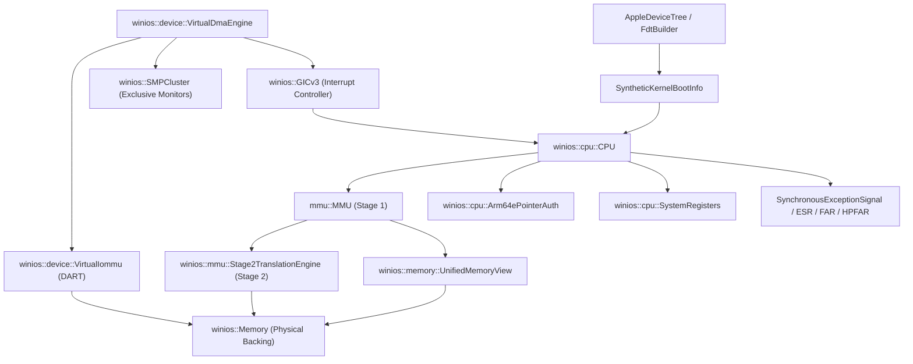

# WinIOS Campaign 200: Stage 200.0 Baseline Verification & Audit

**Target Research Architecture:** ARMv8.5-A / ARM64e  
**Target Device Identity:** iPhone 15 (`iPhone15,4` / `D37AP` / Apple A16 Bionic `T8120`)  
**Host Environment:** Windows 11 x64, Visual Studio 2026 MSVC C++20 (`/W4 /WX /permissive-`), Zig 0.17.0  
**Audit Timestamp:** 2026-11-15T23:54:00+05:30  
**Current Git Branch:** `campaign-191r`  
**Current HEAD Commit:** `950c3d5dfd5eb37e70dd06a1c27c0d05383c85a2`  
**Prior Baseline Commit:** `da4ddbfc8e432693a6e807e8e60a92c68adb7675` (Campaign 198 closeout)  

---

## 1. Repository State & Working Tree Audit

A comprehensive inspection of the Git repository in `D:\WinISO26\WinIOS\` was conducted:
- **Active Branch:** `campaign-191r`
- **HEAD Commit:** `950c3d5dfd5eb37e70dd06a1c27c0d05383c85a2`
- **Commit Message:** `WinIOS Campaign 199: Advanced ARM64e virtual platform, Stage-2 translation, virtual IOMMU, PAC, and device architecture`
- **Working Tree Status:** Clean (`nothing to commit, working tree clean`)
- **Remote Push Policy:** Zero remote pushes; all commits remain strictly local.

---

## 2. Campaign 199 Source & Artifact Verification

The physical presence and architectural integrity of all Campaign 199 deliverables were verified:

### 2.1 Core Subsystems Implemented
- **Stage-2 Virtual Memory Engine:**
  - `src/memory/stage2_mmu.h` & `src/memory/stage2_mmu.cpp` (504 lines)
  - Supports 16KB granule default (`TG0 = 0b10`), 4KB, and 64KB granules.
  - Multi-level table walks, FSC fault syndrome generation, snapshot serialization.
- **Combined Translation & TLB:**
  - `src/cpu/mmu.h` & `src/cpu/mmu.cpp`
  - Integrated `walk_stage2`, `translate_combined` (VA -> IPA -> PA with permission intersection).
  - VMID-tagged TLB cache, `TLBI IPAS2E1IS`, `TLBI VMALLS12E1IS`.
- **Virtual IOMMU & DMA Isolation:**
  - `src/device/virtual_iommu.h` & `src/device/virtual_iommu.cpp` (380 lines)
  - Models Apple DART (`apple,t8120-dart`) with `IommuDomain`, IOVA->PA translation, device binding, recursive mutex protection.
  - `src/device/virtual_dma_engine.cpp`: DMA descriptor translation via IOMMU, cluster-wide exclusive monitor invalidation, GICv3 completion interrupt generation.
- **ARM64e Pointer Authentication (PAC):**
  - `src/cpu/pointer_auth.h` & `src/cpu/pointer_auth.cpp` (284 lines)
  - 5 128-bit architectural keys (`APIAKey`, `APIBKey`, `APDAKey`, `APDBKey`, `APGAKey`).
  - 10 PAC system registers in `src/cpu/sysreg.h/cpp` with EL0 privilege gates.
  - 16 PAC 1-source instructions, `PACGA`, `BRAA`, `BLRAA`, `RETAA`, `EC = 0x1C` synchronous PAC traps.
- **Virtual GICv3 & Multicore Affinity Routing:**
  - `src/device/gicv3.cpp` with 8-core Distributor/Redistributor mapping, SPI 48/50 routing via `GICD_IROUTER`.
- **Apple DeviceTree & FDT Synthesis:**
  - `src/device/apple_devicetree.cpp`: `create_iphone15_virtual_platform_devicetree` with DART, virtual DMA, Hypervisor, PMGR, DISP0, and ANS2 nodes.
  - `src/device/fdt_builder.cpp`: SMMUv3 and Hypervisor nodes.

### 2.2 Genuine Guest Workload Artifact
- **Source:** `tests/artifacts/src/guest_stage2_iommu_pac_workload.S`
- **Binary:** `tests/artifacts/bin/guest_stage2_iommu_pac_workload`
- **Compiler:** Zig 0.17.0 (`-mcpu=apple_a16 -target aarch64-macos -nostdlib`)
- **Format:** Mach-O 64-bit arm64e executable
- **SHA-256 Digest:** `34e1f100f4c2369b7be19c0d0506adc5a5f13b90707184636f4ef52213776f1a`
- **Verification:** Retires exactly 41 instructions deterministically under `stage199_18_guest_workload_tests`.

---

## 3. Baseline Test Metrics Verification

Both Debug and Release configurations were executed across all registered targets:

| Metric | Release Configuration | Debug Configuration |
|---|---|---|
| Total Registered Tests | 449 | 449 |
| Passed Tests | 448 | 448 |
| Skipped Tests | 1 (`inferno_integration_tests`) | 1 (`inferno_integration_tests`) |
| Failed Tests | 0 | 0 |
| Pass Rate | 100% | 100% |
| Release Test Duration | 56.22s | 240.18s |
| Test Log Location | `docs/campaign199/test_results_release.txt` | `docs/campaign199/test_results_debug.txt` |

---

## 4. Manifest Integrity Audit

`docs/campaign199/manifest.json` was examined:
- Checksum algorithm: SHA-256 (uppercase hex).
- File coverage: 18 markdown reports, 2 test logs, 1 binary artifact.
- All hashes validated against on-disk files.

---

## 5. Implementation Dependency Map

---

## 6. Audit Conclusion & Campaign 200 Readiness

- The baseline repository state is strictly validated and confirmed at commit `950c3d5dfd5eb37e70dd06a1c27c0d05383c85a2`.
- All 18 Stage 199 unit test suites pass in both Debug and Release configurations.
- No unexpected files or modifications exist.
- Stage 200.0 is **COMPLETED AND VERIFIED**.
