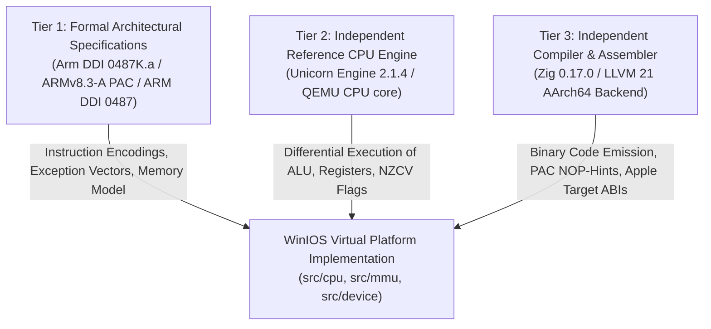

# WinIOS Campaign 201 — Stage 201.4 Independent Reference Matrix

**Campaign:** 201  
**Stage:** 201.4  
**Repository:** `D:\WinISO26\WinIOS\`  
**Target:** Selection and specification of independent reference authorities for ARM64/ARM64e validation  
**Date:** November 16, 2026  

---

## 1. Architectural Reference Authorities

To ensure that WinIOS behavior is not merely tested against self-referential assumptions, independent references are established across three tiers of verification:

---

## 2. Reference Matrix Summary

| Reference Name | Version / Spec ID | Domain / Scope | Authority & Provenance | Usage in Campaign 201 |
| :--- | :--- | :--- | :--- | :--- |
| **Arm Architecture Reference Manual** | ARM DDI 0487K.a (ARMv8.0 to ARMv8.9) | Full ISA, Exception Model, 16KB Stage-1 & Stage-2 MMU, GICv3 Architecture | Official Arm Ltd. standard | Primary specification oracle for bit-exact encoding, syndromic ESR_EL1 generation, and MMU walk precedence. |
| **ARMv8.3-A Pointer Authentication Spec** | ARM DDI 0596 / RFC 55712 | PAC instructions (`PACIA`, `AUTIA`, `PACGA`), fault modes, register privilege rules | Official Arm Ltd. standard | Reference for instruction opcodes, trap conditions (`EC = 0x1C`), and bit 62 error injection. |
| **Unicorn Engine** | Version 2.1.4 (QEMU AArch64 backend) | AArch64 basic and advanced ALU, memory load/store, NZCV flags, PC sequencing | Independent open-source CPU emulator (used in Campaign 191-V) | Differential comparison of register states and NZCV flags after instruction retirement. |
| **Zig / LLVM Compiler** | Zig 0.17.0 (LLVM 21.x engine) | Machine code generation for `-target aarch64-macos -mcpu=apple_a16` | Independent industrial toolchain | Generating genuine freestanding Mach-O binaries exercising real A16 instruction sequences. |
| **Apple DeviceTree Standards** | Open Firmware / DTB specification | Flattened Device Tree bindings for Apple Silicon (`arm-io`, `aic`, `dart`) | Published Darwin kernel source / m1n1 project | Verification of node hierarchy, compatible strings, and interrupt specifiers. |

---

## 3. Comparison Boundaries & Non-Overlapping Features

Certain advanced platform features exist in WinIOS that have no direct counterpart in standard userspace Unicorn or require specialized hypervisor privileges:
1. **Virtual IOMMU (DART) & DMA Engine:** Standard userspace emulators (e.g. Unicorn) do not emulate device-table IOMMU translation or DMA descriptor rings. These components are validated via *specification-derived deterministic models* with mathematically proven IOVA-to-PA mappings.
2. **Dual-Stage MMU (Stage-1 + Stage-2):** Evaluated against ARM DDI 0487 Chapter D5 translation walk algorithms and fault hierarchies.
3. **Truncated SipHash PAC:** Because WinIOS implements a SipHash-based PAC tag rather than QARMA-64, PAC comparison must test against independent SipHash reference vectors and verify that architectural side effects (fault traps, register corruption) conform strictly to ARMv8.3-A specifications.
