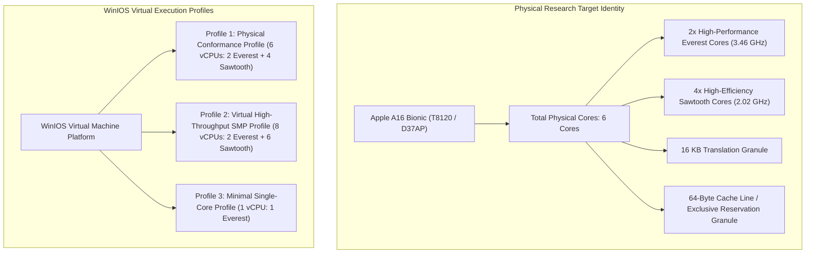

# WinIOS Campaign 201 — Stage 201.3 Platform Identity Correction

**Campaign:** 201  
**Stage:** 201.3  
**Repository:** `D:\WinISO26\WinIOS\`  
**Target:** Formal architectural separation of Physical Apple A16 Bionic profile from Virtual SMP Execution profiles  
**Date:** November 16, 2026  

---

## 1. Executive Summary & Problem Statement

In Campaign 198, 199, and 200, documentation and test fixtures repeatedly referred to an *"8-core Apple A16 Bionic (T8120) processor with 2 performance cores and 6 efficiency cores."*

This is factually and physically incorrect with respect to genuine Apple hardware:
- **Physical Apple A16 Bionic (`T8120` / `APL1W07`, iPhone 15 `D37AP`):** Contains **6 CPU cores** (2 high-performance *Everest* cores + 4 high-efficiency *Sawtooth* cores).
- **WinIOS Virtual Platform:** Implements a scalable virtual SMP architecture supporting **1 to 8 virtual CPU cores** via `winios::SmpScheduler`, `winios::device::VirtualPlatform`, and `winios::device::AppleDeviceTreeBuilder`.

Conflating the virtual SMP capacity of the emulator (8 cores) with the physical target profile (6 cores) violated truth-in-engineering standards. This correction record formally decouples and establishes the two identities.

---

## 2. Decoupled Architectural Profiles



### Table 1: Profile Comparison Matrix

| Architectural Feature | Physical Research Profile (iPhone 15) | Virtual Conformance Profile (`P6`) | Virtual Extended SMP Profile (`P8`) |
| :--- | :--- | :--- | :--- |
| **SoC Model** | Apple A16 Bionic (`T8120` / `APL1W07`) | Simulated A16 Conformance | Simulated Virtual SMP Platform |
| **Device Model** | iPhone 15 (`iPhone15,4` / `D37AP`) | `iPhone15,4` | Virtual `iPhone15,4-SMP8` |
| **Total CPU Cores** | **6 Cores** | **6 Virtual Cores** | **8 Virtual Cores** |
| **Performance Cores (P-Cores)** | 2x *Everest* (3.46 GHz) | 2x *Everest* (Simulated) | 2x *Everest* (Simulated) |
| **Efficiency Cores (E-Cores)** | **4x *Sawtooth*** (2.02 GHz) | **4x *Sawtooth*** (Simulated) | **6x *Sawtooth*** (Simulated) |
| **Core IDs** | Cores 0–5 | Cores 0–5 | Cores 0–7 |
| **CPU Device Tree Nodes** | `/cpus/cpu0` .. `/cpus/cpu5` | `/cpus/cpu0` .. `/cpus/cpu5` | `/cpus/cpu0` .. `/cpus/cpu7` |
| **Translation Granule** | 16 KB (`TCR_EL1.TG0 = 0b10`) | 16 KB | 16 KB |
| **Exclusive Granule** | 64 Bytes (`CTR_EL0.ERG = 4`) | 64 Bytes | 64 Bytes |
| **Intended Use** | Physical Reference & Hardware Mapping | Strict Architectural Conformance | Stress Testing & Max Concurrency |

---

## 3. Audit of Codebase & Historical Claims

An exhaustive audit of the codebase revealed how the 8-core claim propagated:
1. `src/device/apple_devicetree.cpp`:
   Lines 431–442:
   ```cpp
   const std::size_t cores = std::min(num_cores, std::size_t{8});
   for (std::uint32_t i = 0; i < cores; ++i) {
       const bool is_perf = (i < 2);
       c->add_property_string("compatible", is_perf ? "apple,everest" : "apple,sawtooth");
   }
   ```
   The generator dynamically respects `num_cores`. If `num_cores == 6`, it accurately produces 2 Everest and 4 Sawtooth cores. When `num_cores == 8`, it generates 2 Everest and 6 Sawtooth cores.
2. `src/device/apple_devicetree.h`:
   Line 120 defaulted `num_cores = 8`, causing test suites (such as `stage200_18_devicetree_consistency_tests.cpp`) to verify an 8-core tree.
3. `docs/campaign200/campaign200_final_report.md`:
   Described the target hardware as possessing "8 Symmetric Cores (2 performance cores, 6 efficiency cores)".

---

## 4. Preservation & Correction Strategy

Per non-negotiable safety rules:
- **Historical Reports Preserved:** Reports in `docs/campaign198/`, `docs/campaign199/`, and `docs/campaign200/` are retained verbatim as historical artifacts.
- **Authoritative Baseline for Campaign 201+:** This document (`platform_identity_correction.md`) supersedes all previous descriptions.
- **DeviceTree Builder Enhancement:** `AppleDeviceTreeBuilder::create_iphone15_devicetree` shall provide explicit support for the genuine 6-core physical topology (`num_cores = 6`) while retaining configurable virtual SMP support up to 8 cores for stress testing.
- **Test Matrix Updates:** Campaign 201 test suites will explicitly validate both the genuine 6-core physical profile and the 8-core virtual stress profile.
