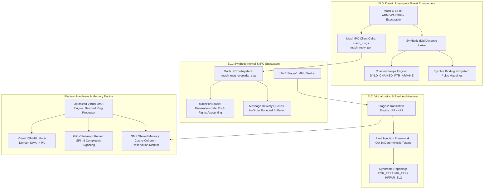

# WinIOS Campaign 202 — Stage 202.2 Darwin Runtime Architecture

**Campaign:** 202  
**Stage:** 202.2  
**Repository:** `D:\WinISO26\WinIOS\`  
**Target Identity:** iPhone 15 (`iPhone15,4` / `D37AP` / Apple A16 Bionic `T8120`)  
**Host Architecture:** Windows 11 x64  
**Date:** November 16, 2026  
**Status:** Canonical Architectural Specification  

---

## 1. Executive Summary

This document specifies the unified architecture of the WinIOS synthetic Darwin runtime layer for Campaign 202. The objective is to modernize Mach-O dynamic linking and chained fixups, deepen synthetic Mach IPC port-right mechanics, establish an architectural EL2 Stage-2 fault injection and syndrome reporting framework, and optimize DMA descriptor ring processing—all while preserving strict memory isolation, ARM DDI 0487 compliance, and reproducible testing evidence.

---

## 2. Architectural Subsystem Layout

The synthetic Darwin runtime operates entirely in guest address space, mediated by host C++20 virtualization engines:

---

## 3. Subsystem Specifications

### 3.1 Mach-O & Chained Fixups (`DyldEngine`)
- **Fixup Container:** Parses `LC_DYLD_CHAINED_FIXUPS` (`DyldChainedFixupsHeaderRaw`).
- **Starts Structure:** `DyldChainedStartsInImageRaw` and `DyldChainedStartsInSegmentRaw` with page starts array (stride: 16KB / 4KB).
- **Supported Pointer Formats:**
  * `DYLD_CHAINED_PTR_64` / `DYLD_CHAINED_PTR_64_OFFSET`: Standard 64-bit rebase and bind chains.
  * `DYLD_CHAINED_PTR_ARM64E` / `DYLD_CHAINED_PTR_ARM64E_USERLAND`: 64-bit pointers featuring PAC authentication metadata (key, diversity, address-diversity), ordinal, and next-chain offset.
- **Safety Invariant:** All chained pointer walks are bounds-checked against segment virtual addresses and image buffers. Out-of-bounds next offsets terminate with transactional error status (`InvalidChainedFixups`) without partial memory corruption.

### 3.2 Synthetic Mach IPC Subsystem (`MachIpcSubsystem`)
- **Port Identity:** Generation-safe 32-bit handles (`mach_port_t`) allocated through `MachPortSpace`.
- **Right Types:**
  * `kMachPortRightSend`: Multiple senders allowed; reference counted.
  * `kMachPortRightReceive`: Unique receiving endpoint bound to message queue.
  * `kMachPortRightSendOnce`: Ephemeral right destroyed upon message transmission.
  * `kMachPortRightDeadName`: Preserves handle stability upon port destruction.
- **Message Dispatch:** Supports `mach_msg_overwrite_trap` (XNU syscall -32) with options `MACH_SEND_MSG`, `MACH_RCV_MSG`, timeouts, and bounded queue capacity.
- **Descriptors:** Validates port descriptors (`MACH_MSG_PORT_DESCRIPTOR`) and out-of-line memory descriptors (`MACH_MSG_OOL_DESCRIPTOR`) with strict guest memory bounds enforcement.

### 3.3 EL2 Stage-2 Translation Fault Architecture (`Stage2TranslationEngine`)
- **Fault Categories:** Translation Fault (FSC 0x04..0x07), Access Flag Fault (FSC 0x08..0x0B), Permission Fault (FSC 0x0C..0x0F), Address Size Fault (FSC 0x00..0x03).
- **Syndrome Modeling:**
  * `ESR_EL2`: Encodes Exception Class (0x24 Data Abort / 0x20 Instruction Abort from lower EL), Instruction Specific Syndrome (ISS: SAS, SSE, SRT, SF, AR, FnV, EA, WnR, S1PTW, FSC).
  * `FAR_EL2`: Captures Faulting Virtual Address (VA).
  * `HPFAR_EL2`: Captures Faulting Intermediate Physical Address shifted right by 8 (`IPA[47:12] << 4`).
- **Opt-In Fault Injection:** Deterministic, programmatic fault injection enabling testing of hypervisor page-fault handling without polluting production execution paths.

### 3.4 Optimized DMA Ring Architecture (`VirtualDmaEngine`)
- **Descriptor Ring:** Memory-mapped circular ring buffer with Producer/Consumer head/tail indices.
- **Optimization Strategy:**
  * Batched descriptor ingestion: processes multi-descriptor transfers in a contiguous pipeline.
  * Direct contiguous host span memory copies when source and destination PAs fall within flat guest physical memory ranges.
  * Complete preservation of IOMMU translations, permission validation, exclusive-monitor reservation invalidation, and GICv3 interrupt completion signaling.
- **Coherency Invariant:** Writes to guest physical memory trigger reservation invalidations across all SMP cores in `SmpExclusiveMonitorManager`.
