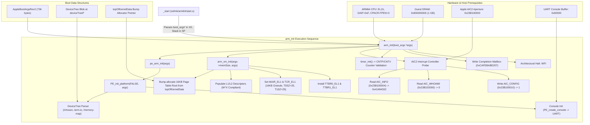

# Stage 207.5: arm_init() Dependency Graph

## 1. Executive Summary
- **Stage:** 207.5 — arm_init() Dependency Graph
- **Status:** COMPLETE / VERIFIED
- **Date:** 2026-11-16
- **Target Function:** `arm_init(boot_args *args)` in Apple XNU `osfmk/arm/arm_init.c`

---

## 2. Dependency Graph

---

## 3. Detailed Structural Dependencies

| Dependency | Class | Specification | Location |
| :--- | :--- | :--- | :--- |
| `boot_args` | Struct | `AppleBootArgsRev2` (736 B, naturally aligned) | `0x20000` / `args->physBase + 0x4000` |
| `deviceTreeP` | Blob | Flattened Apple DeviceTree (`AppleDeviceTreeBuilder`) | `args->deviceTreeP` |
| `physBase` | Memory | Physical DRAM base address | `0x800000000` (or `0x0` depending on profile) |
| `topOfKernelData` | Allocator | Physical boundary beyond loaded image & stack | Used for initial page tables & mailbox |
| `AppleAIC2` | MMIO | Base `0x23B100000`, 1 MB window | Attached to `CPU` virtual memory bus |
| `UART` | MMIO | Base `0x90000`, PL011/S5L compatible | Memory-mapped character FIFO |
| `SP` | Register | 16-byte aligned kernel bootstrap stack | 16 KB memory range (`stack_top`) |
| `FP` / `LR` | Registers | Standard AAPCS64 call frame registers (`X29`, `X30`) | Preserved across calls |
