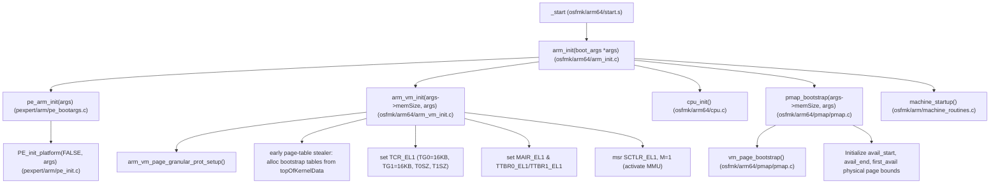

# WinIOS Stage 208.6: XNU VM Bootstrap Dependency Graph

## 1. Pinned Source Dependency Chain
Analysis of Apple `xnu-10002.1.13` reveals the following sequential call graph during Darwin/XNU machine-dependent startup on Apple Silicon:

## 2. Analysis of Next Initialization Milestones
Following `PE_init_platform`, genuine XNU requires:
1. **`arm_vm_init` expansion:**
   - Real 16KB translation table hierarchy.
   - Stealing multiple 16KB pages above `topOfKernelData` for Level 1 table, Level 2 tables, and Level 3 page tables.
   - Configuring `TCR_EL1` for 16KB translation granule (`TG0 = 2`, `TG1 = 1`).
   - Configuring `MAIR_EL1` with Normal memory and Device-nGnRE memory attributes.
   - Configuring `TTBR0_EL1` (Identity map) and `TTBR1_EL1` (Higher-half kernel VA).
2. **`pmap_bootstrap` invocation:**
   - Physical memory map registration (`avail_start`, `avail_end`, `first_avail`).
   - Tracking allocated physical page frames.
   - Ensuring `topOfKernelData` advances deterministically past page tables.

## 3. Unresolved Prerequisites & Boundary Identification
- Full `machine_startup` requires Mach IPC task creation, BSD VFS mount, and Mach scheduler threads.
- For Stage 208, the achievable and verifiable genuine guest execution boundary is:
  `_start` $\rightarrow$ `arm_init` $\rightarrow$ `pe_arm_init` $\rightarrow$ `PE_init_platform` $\rightarrow$ `arm_vm_init` (with real 16KB multi-level tables and MMU enable) $\rightarrow$ `pmap_bootstrap` (physical memory bounds registration).
