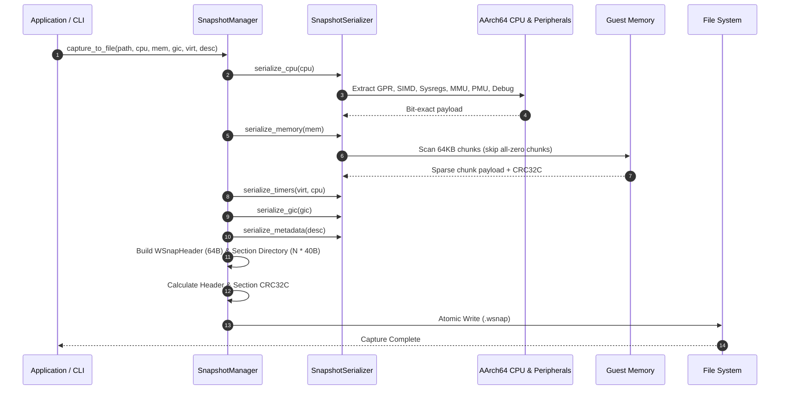
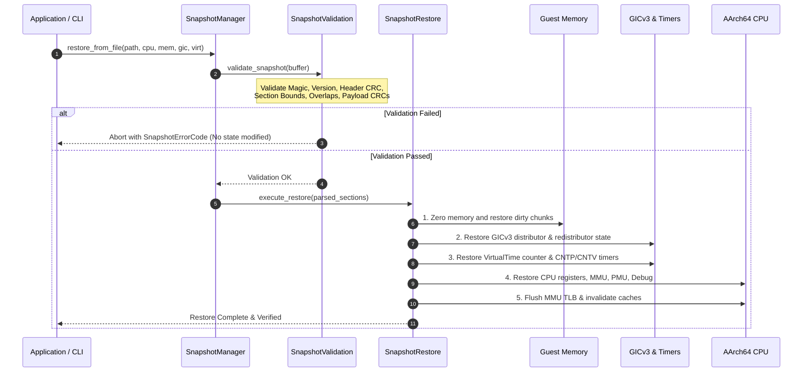

# WinIOS Phase 52, Stage 17: Architectural State Snapshot Architecture

## 1. Executive Summary

This document specifies the architectural design, component responsibilities, transactional guarantees, and lifecycle workflows of the WinIOS Architectural Snapshot Engine (`.wsnap`).

As part of Phase 52 ("Deterministic Execution, Dynamic Tracing, and Replay Infrastructure"), Stage 17 establishes the foundational **snapshot capture and restoration subsystem** required by the Snapshot + Non-Deterministic Log (SNDL) execution architecture designed in Stage 16. The snapshot engine allows saving the complete architectural state of the emulated system (CPU registers, PMU, hardware debug architecture, physical memory, virtual timers, and interrupt controllers) to a versioned binary file, and restoring that state transactionally with bit-exact fidelity.

```
       +-------------------------------------------------------+
       |               SnapshotManager Orchestrator            |
       +---------------------------+---------------------------+
                                   |
         +-------------------------+-------------------------+
         |                                                   |
         v                                                   v
+------------------------+                          +------------------------+
|   SnapshotSerializer   |                          |    SnapshotRestore     |
| (Bit-Exact Encoders)   |                          | (Transactional Engine) |
+-----------+------------+                          +------------+-----------+
            |                                                    ^
            v                                                    |
+------------------------+                          +------------+-----------+
|      WSnap Format      |                          |   SnapshotValidation   |
| (64B Hdr + 40B Desc)   |=========================>|  (Pre-flight Verifier) |
+-----------+------------+      .wsnap file         +------------------------+
            |                                                    ^
            +----------------- CRC32C Integrity -----------------+
```

---

## 2. Architectural Objectives and Non-Objectives

### 2.1 Objectives
1. **Bit-Exact Architectural Fidelity**: Capture and restore 100% of implemented WinIOS architectural state without loss, precision truncation, or corruption.
2. **Transactional Restore Safety**: Validate snapshots completely (header magic, version, CRC32C, section directory layout, section boundary overlaps, and payload CRC32C) *before* applying any mutations to guest hardware state.
3. **Sparse Memory Serialization**: Efficiently encode guest physical memory using 64 KB sparse chunks, skipping all unwritten/zero pages to minimize snapshot file size and I/O overhead.
4. **Independent Format Decoupling**: Strictly isolate the snapshot file format (`.wsnap`) from the diagnostic trace format (`.wtr` 64-byte `TraceEvent`), preserving backward compatibility and operational separation.
5. **Deterministic Restoration Ordering**: Enforce a strict physical dependency hierarchy during restore: Memory $\to$ Interrupt Controller (GICv3) $\to$ Virtual Timers $\to$ CPU Cores $\to$ TLB Invalidation.

### 2.2 Non-Objectives
- **No Non-Deterministic Log Recording**: Recording asynchronous interrupts, DMA transfers, or external entropy belongs to Stage 18.
- **No Instruction Replay**: Replaying recorded execution streams from snapshots belongs to Stage 19.
- **No Compression Algorithms Requiring Heavy Runtimes**: Standard 64 KB chunk sparse encoding with CRC32C is implemented natively without third-party compression dependencies (e.g., zstd/lz4), keeping the engine lean and deterministic.

---

## 3. Subsystem Component Responsibilities

The snapshot subsystem is partitioned into modular components located in `src/snapshot/`:

| Component Header | Source File | Responsibilities |
|---|---|---|
| `snapshot_types.h` | — | Defines core enumerations (`SnapshotSectionType`, `SnapshotCompressionType`, `SnapshotErrorCode`), and result wrappers (`SnapshotResult`, `SnapshotValidationResult`). |
| `wsnap_format.h` | `wsnap_format.cpp` | Implements binary header (64 bytes) and section descriptor (40 bytes) schemas, endian conversions, CRC32C calculations, and section directory serializations. |
| `snapshot_serializer.h` | `snapshot_serializer.cpp` | Provides bit-exact binary encoders and decoders for CPU, PMU, Debug Architecture, Sparse Memory, Virtual Timers, GICv3, and Metadata. |
| `snapshot_validation.h` | `snapshot_validation.cpp` | Performs exhaustive pre-flight verification: file size, magic, version, header CRC, section counts, bounds, non-overlapping section spans, and payload CRC32C. |
| `snapshot_restore.h` | `snapshot_restore.cpp` | Coordinates safe transactional restoration against live hardware models, enforcing correct restoration sequencing and TLB flushing. |
| `snapshot_manager.h` | `snapshot_manager.cpp` | High-level orchestrator providing clean API for capture, save, load, restore, validate, and inspect operations. |

---

## 4. Hardware Model Extensions

To support non-intrusive, thread-safe state extraction and restoration, minor architectural accessors were introduced to the underlying core models:

1. **Guest Memory (`src/memory/memory.h`)**:
   - `raw_data() const`: Read-only access to underlying memory vector under striping locks for chunk scanning.
   - `raw_data()`: Mutable access for transactional block restoration.
   - `reset_zero()`: Atomic zero-fill under memory lock stripes prior to sparse chunk restoration.
2. **GICv3 (`src/cpu/gicv3.h`)**:
   - `DistributorState`: POD struct encapsulating distributor configuration (CTLR, enable groups, priority masks, pending bitmasks).
   - `get_distributor_state()` / `set_distributor_state()`: Thread-safe state capture and restoration.
3. **AArch64 CPU (`src/cpu/cpu.h`)**:
   - `set_started(bool)` & `set_stopped(bool)`: CPU lifecycle restoration.
   - `set_instruction_trace_sequence(uint64_t)`: Trace sequence counter restoration to preserve trace continuity.

---

## 5. Capture Workflow



1. **Pause Hardware Models**: All core worker threads and device models are quiesced.
2. **Extract Architectural State**: Each subsystem's state is extracted into canonical little-endian byte buffers.
3. **Sparse Chunk Memory Scan**: Memory is divided into 64 KB chunks. Chunks consisting entirely of zero bytes are skipped. Non-zero chunks are tagged with their 64-bit physical base address, byte length, and chunk CRC32C.
4. **Directory Construction**: The 64-byte `WSnapHeader` and $N$ 40-byte `WSnapSectionDescriptor` records are generated, allocating contiguous offsets in the snapshot file.
5. **CRC32C Integrity Sealing**: Header and section checksums are calculated using hardware-accelerated CRC32C (`winios::crc32c`).
6. **File Emission**: The serialized snapshot is written atomically to disk.

---

## 6. Transactional Restoration Workflow



### Transactional Guarantees
- **Zero In-Place Corruption**: If a snapshot fails validation (e.g., bit flipped in a memory chunk, invalid section offset, unknown section type), `SnapshotValidation` rejects the image *before* touching a single register or memory byte.
- **Ordered Restoration**:
  1. Memory state is cleared and repopulated with sparse chunks.
  2. GICv3 distributor state, interrupt priorities, and routing are configured.
  3. Physical virtual counter, timer registers, and comparators are restored.
  4. Architectural CPU registers, system registers, PMU, and debug watchpoints are restored.
  5. The MMU TLB is invalidated (`cpu.mmu().invalidate_tlb()`) ensuring no stale virtual address translations persist from pre-snapshot execution.

---

## 7. Thread-Safety Model

- **Capture Safety**: During snapshot capture, memory lock striping (`stripe_mutex_`) guarantees coherent reads across guest memory partitions while preventing concurrent DMA or execution modifications.
- **Restore Safety**: Restoration takes exclusive locks on the guest memory subsystem and assumes the CPU core threads are in a stopped or paused state.
- **Concurrent Readers**: Multiple inspection or validation operations (`SnapshotManager::inspect_file` / `validate_file`) can execute concurrently without mutex contention.
