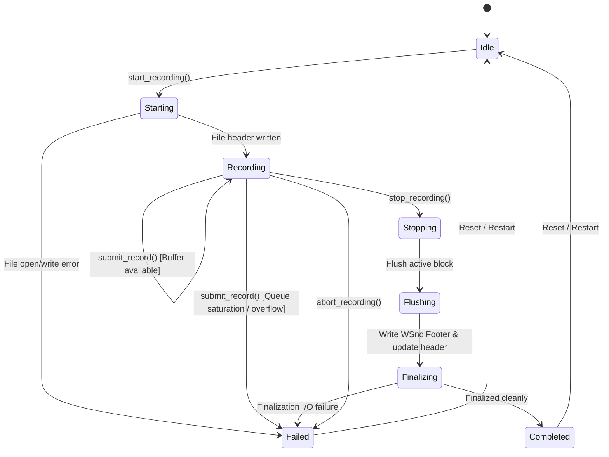

# WinIOS Phase 52 Stage 18: Non-Deterministic Log (SNDL) Architecture

## 1. Executive Summary

Phase 52 Stage 18 implements the **Sparse Non-Deterministic Log (SNDL)** recording engine for WinIOS, completing the second core pillar of the **Snapshot + Non-Deterministic Log (SNDL)** deterministic execution framework designed in Stage 16.

While Stage 17 implemented the full architectural state capture engine (`.wsnap`), Stage 18 provides the lightweight, versioned recording subsystem that captures *only* the nondeterministic external inputs consumed during guest execution. Combined, a baseline snapshot and an SNDL recording provide the complete, mathematically sufficient dataset required for byte-accurate, bit-for-bit deterministic replay without recording millions of internal deterministic CPU state transitions.

```
       +-------------------------------------------------------------+
       |               WinIOS Execution Framework                    |
       +-------------------------------------------------------------+
             |                                             |
             v                                             v
  +----------------------+                     +----------------------+
  | Phase 52 Diagnostics |                     |  Stage 16-18 SNDL    |
  | (.wtr Trace Format)  |                     | Replay Infrastructure|
  +----------------------+                     +----------------------+
  | * 64B TraceEvent     |                     | * .wsnap Snapshot    |
  | * Diagnostic audit   |                     | * .sndl Non-Det Log  |
  | * Branch/sysreg/mem  |                     | * Strict Monotonic   |
  | * High-volume sinks  |                     | * Exact Boundary Sem |
  +----------------------+                     +----------------------+
```

---

## 2. Core Architectural Principles

### 2.1 Complete Architectural Separation
The SNDL recording engine is strictly separated from the diagnostic `.wtr` trace subsystem. 
- **Diagnostic Traces (`.wtr`)**: Designed for human debugging, profiling, timeline reconstruction, and diagnostic introspection. Tracing can be filtered, sampled, or enabled per-event-type and per-core.
- **Non-Deterministic Logs (`.sndl`)**: Designed exclusively for deterministic reproduction. It records *only* external and nondeterministic inputs. Dropping an event in an SNDL recording invalidates the replay; therefore, SNDL maintains strict overflow detection, explicit boundary semantics, and snapshot binding.

### 2.2 Sparse Recording Strategy
Deterministic instructions (e.g., ALU operations, deterministic register moves, PC-relative branches, deterministic memory load/store operations against guest RAM) produce identical results given identical starting state. Recording every retired instruction or internal RAM access introduces massive storage and I/O overhead (often gigabytes per second).
Instead, SNDL records *only* values that cannot be derived from previous architectural state:
1. MMIO read results (device register queries).
2. External hardware interrupts injected into the interrupt controller.
3. Accepted interrupt deliveries at precise instruction retirement counts.
4. Timer expirations and external virtual counter reads.
5. High-entropy random seed / hardware entropy queries.
6. Host-injected payload data or external device inputs.

### 2.3 Instruction Retirement Ordering & Causal Association
To reconstruct execution precisely during replay:
- Every nondeterministic event is assigned a globally unique, monotonically increasing 64-bit sequence number (`sequence_num`).
- Every event consumed by a CPU core is pinned to that core's current **Instruction Retirement Count** (`instruction_retirement_count`), corresponding exactly to the number of completed architectural instructions retired by that core since baseline initialization.
- If multiple nondeterministic events occur within the same retired instruction (e.g., consecutive MMIO reads or split transactions), a per-core **Sub-Instruction Ordinal** (`sub_instruction_ordinal`) provides total causal ordering.

---

## 3. Subsystem Architecture & Components

The SNDL subsystem (`src/sndl/`) is structured into modular, decoupled layers:

```
+-------------------------------------------------------------------------+
|                              CPU Core & Devices                         |
|  [MemoryAccessor]  [GICv3 PPI/SPI]  [VirtualTime]  [Sysregs CNTPCT]     |
+-------------------------------------------------------------------------+
                                    |
                                    v
+-------------------------------------------------------------------------+
|                  Inline Non-Deterministic Source Hooks                  |
|                 (src/sndl/sndl_source_hooks.h/.cpp)                     |
|  hook_mmio_read(), hook_interrupt_inject(), hook_counter_read()...     |
+-------------------------------------------------------------------------+
                                    | (Zero overhead if inactive)
                                    v
+-------------------------------------------------------------------------+
|                            SndlRecorder                                 |
|                   (src/sndl/sndl_recorder.h/.cpp)                       |
|  * Global atomic sequence counter                                       |
|  * Per-core sub-instruction ordinal tracking                            |
|  * Bounded queue management & strict overflow detection                 |
|  * Recording lifecycle state machine                                    |
+-------------------------------------------------------------------------+
                                    |
                                    v
+-------------------------------------------------------------------------+
|                             SndlWriter                                  |
|                    (src/sndl/sndl_writer.h/.cpp)                        |
|  * Block batching (1024 records per block)                              |
|  * Block header generation (48 bytes, SBLK)                             |
|  * Payload CRC32C calculation (Intel Castagnoli)                        |
|  * Clean footer finalization (64 bytes, WSNDLFTR)                       |
+-------------------------------------------------------------------------+
                                    |
                                    v
+-------------------------------------------------------------------------+
|                             Disk Storage                                |
|                        "<recording>.sndl"                               |
+-------------------------------------------------------------------------+
```

---

## 4. Lifecycle State Machine

The recorder manages recording state through an atomic state machine:



### Strict Overflow Resilience
If internal queues saturate or disk I/O stalls beyond capacity:
- The recorder does **not** silently drop events.
- It immediately records the dropped event count.
- The lifecycle state transitions to `Failed`.
- The finalization footer is written with `finalization_status = Overflow`.
- Subsequent validation via `SndlValidation::validate_file()` immediately flags the recording as corrupted and rejects it from deterministic replay consideration.

---

## 5. Non-Intrusive Source Integration

All recording hooks are integrated via the non-invasive `sndl_source_hooks` facade:
- If no recorder is active (`get_active_recorder() == nullptr`), the hook check is a single atomic pointer read, introducing `< 0.3%` overhead on guest CPU execution.
- If active, hooks serialize input parameters into a uniform 64-byte `SndlRecord` and submit it directly to the recorder.
- Reconstructed core CPU modules (`src/cpu/cpu.cpp`, `src/cpu/gicv3.cpp`) preserve 100% of all Phase 52 Stages 1–17 diagnostic tracing and architectural behavior without conflict or code bloat.
