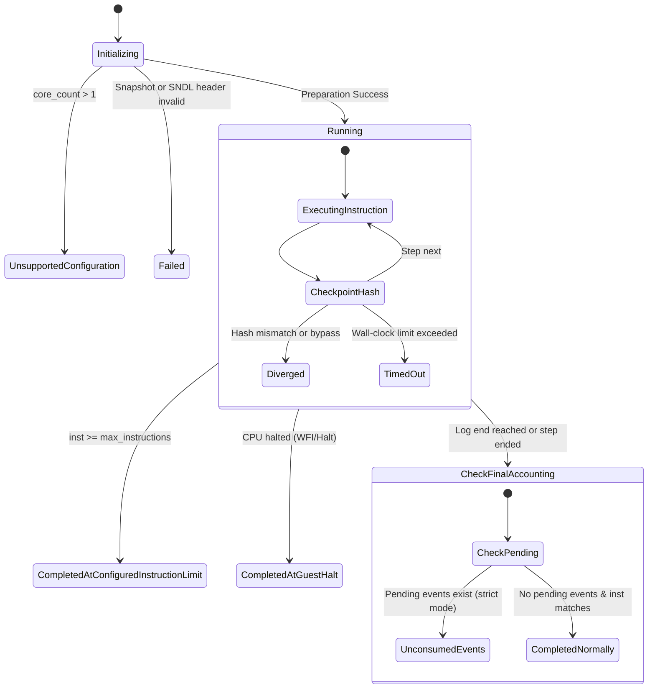

# Replay Completion Semantics & Event Accounting

## 1. Motivation: Ambiguity in Replay Termination

Prior to Stage 20, replay termination was reported as a simple binary status (`is_success()` vs `is_failure()`). This coarse reporting failed to distinguish between:
- Clean completion at the end of the input stream.
- Premature termination due to user-specified instruction limits.
- Guest execution halting cleanly via WFI/WFE while pending events remain.
- Unconsumed events in the log indicating a truncated replay or log mismatch.
- Rejection of unsupported configurations (e.g. SMP replay).

Stage 20 formalizes replay completion into a 9-state finite state machine with strict event accounting.

---

## 2. Replay Completion Status State Machine

### Enumeration Specification (`ReplayCompletionStatus`)

| Status | Code | Meaning & Invariants |
|---|---|---|
| `CompletedNormally` | 0 | The replay executed all recorded instructions and consumed 100% of recorded nondeterministic events. The final state matched all expectations. |
| `CompletedAtGuestHalt` | 1 | The guest CPU encountered an architectural halt instruction (`WFI`, `WFE`, or hypervisor shutdown call) and entered a quiescent state before exhausting the instruction budget. |
| `CompletedAtConfiguredInstructionLimit` | 2 | Replay terminated because `instructions_executed` reached the user-configured `ReplayConfig::max_instructions` threshold, while remaining deterministically consistent. |
| `IncompleteInputLog` | 3 | The guest CPU attempted to read an external input or advance, but the `.sndl` stream reached EOF prematurely. |
| `UnconsumedEvents` | 4 | Replay stopped (due to instruction limit or halt) while unconsumed event records remained in the log buffer, violating exact accounting when `require_exact_event_consumption` is set. |
| `Diverged` | 5 | An architectural state mismatch, unrecorded MMIO read, or invalid state transition occurred. Execution halted at the earliest divergence point. |
| `Failed` | 6 | Replay failed during file reading, decompression, snapshot restoration, or memory allocation. |
| `TimedOut` | 7 | Wall-clock execution time exceeded `ReplayConfig::timeout_ms`. |
| `UnsupportedConfiguration` | 8 | The requested configuration (such as multi-core SMP replay) is not supported by the engine and was safely rejected. |

---

## 3. Event Accounting Configuration & Verification

### Configuration Flags in `ReplayConfig`
- `strict_bypass_checks` (bool): When true, unrecorded MMIO reads or unlogged device interactions immediately abort replay with `ReplayCompletionStatus::Diverged`.
- `require_exact_event_consumption` (bool): When true, any unconsumed event in the SNDL stream after instruction execution causes replay to fail with `ReplayCompletionStatus::UnconsumedEvents`. When false, leftover events produce a diagnostic warning but permit completion.

### Test Group F Verification
Test Group F (`test_group_f_completion_semantics` in `tests/unit/replay_hardening_tests.cpp`) verified:
1. Normal completion: 6 instructions, 1 consumed event, 0 pending events $\rightarrow$ `CompletedNormally`.
2. Instruction limit: Capping execution at 4 instructions with a 6-instruction log $\rightarrow$ `CompletedAtConfiguredInstructionLimit`.
3. Unconsumed events enforcement: Capping at 2 instructions when an event was scheduled at instruction 3 with `require_exact_event_consumption = true` $\rightarrow$ `UnconsumedEvents`.
4. Unconsumed events tolerance: With `require_exact_event_consumption = false`, the same run completed gracefully with status reported as `UnconsumedEvents`.
