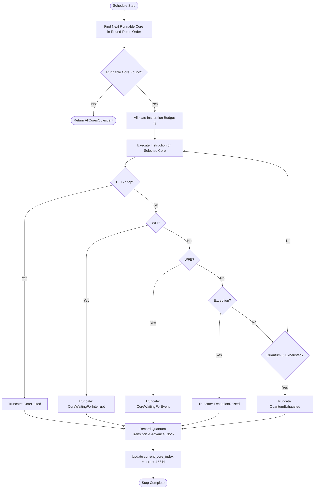

# Deterministic SMP Global Scheduler

## 1. Architectural Scope

Traditional multi-threaded emulators distribute virtual CPU cores across separate host OS threads. While this maximizes host CPU utilization, it fundamentally introduces non-deterministic thread scheduling jitter, arbitrary thread preemption, and unpredictable memory race interleavings. Consequently, deterministic record and replay becomes mathematically impossible without recording every single cross-thread memory load.

The `SmpScheduler` (`src/cpu/smp_scheduler.h`, `src/cpu/smp_scheduler.cpp`) implements a **single-host-thread deterministic round-robin scheduler** with configurable instruction slice budgets ($Q$).

---

## 2. Scheduling Algorithm & Round-Robin Selection

### Scheduling Properties:
1. **Ascending Core Selection**: Cores are inspected in ascending order: $(0, 1, \dots, N-1, 0, \dots)$.
2. **Quiescence Skipping**: Halted cores (`CoreLifecycleState::Halted`) and stopped cores (`CoreLifecycleState::Stopped`) are skipped immediately without executing instructions.
3. **WFI Awakening**: If a core is quiescent in WFI (`WaitingForInterrupt`), the scheduler inspects `SmpInterruptRouter::has_pending(core_id)`. If an unmasked interrupt is pending, the interrupt is delivered, the core is awakened to `Runnable`, and execution proceeds immediately.
4. **WFE Awakening**: If a core is quiescent in WFE (`WaitingForEvent`) and its event register is asserted, the core is awakened to `Runnable`.

---

## 3. Quantum Enforcement & Truncation Triggers

Each scheduling quantum is allocated a budget of $Q$ instructions (default: 10,000 instructions).
A quantum terminates when either:
1. **$Q$ Instructions Retired**: The core completes all $Q$ instructions (`QuantumTruncationReason::QuantumExhausted`).
2. **HLT Instruction**: Core halts execution (`CoreHalted`).
3. **WFI Instruction**: Core executes Wait For Interrupt without pending interrupt (`CoreWaitingForInterrupt`).
4. **WFE Instruction**: Core executes Wait For Event without event asserted (`CoreWaitingForEvent`).
5. **Architectural Exception**: Synchronous exception taken (`ExceptionRaised`).
6. **Cross-Core IPI / SGI**: Core issues cross-core interrupt signal (`InterProcessorInterrupt`).
7. **Synchronization Barrier**: Explicit DMB/DSB/ISB boundary reached (`SynchronizationBarrier`).

Early truncation ensures that interaction points between cores occur with minimal latency, avoiding long starvation windows.

---

## 4. Multi-Core Canonical State Hash

To verify bit-exact determinism across multicore runs, `SmpScheduler::compute_canonical_multicore_hash()` combines:
1. Number of registered cores ($N$)
2. Monotonic global retirement sequence ($S_{\text{global}}$)
3. For each active core $i \in [0, N-1]$ in ascending order:
   - Core ID $i$
   - `SmpCoreState::compute_canonical_hash()`
   - Core instruction retirement count
4. Full CRC32C hash of guest shared memory

Identical initial state and workload executed under this scheduler will produce 100% identical canonical multicore state hashes regardless of host hardware, CPU frequency, or operating system load.
