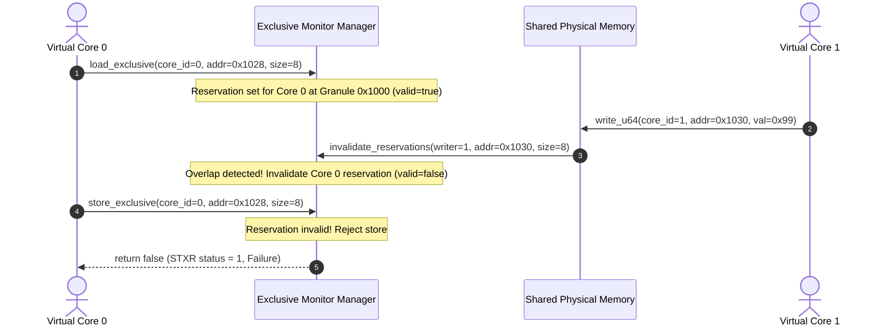

# ARM Exclusive Monitor Architecture (LDXR / STXR / CLREX)

## 1. Architectural Scope

ARMv8-A architecture defines Load-Linked / Store-Conditional primitives for atomic synchronization and lock-free data structures:
- `LDXR` / `LDAXR` (Load Exclusive / Load-Acquire Exclusive)
- `STXR` / `STLXR` (Store Exclusive / Store-Release Exclusive)
- `CLREX` (Clear Exclusive)

In a multi-core system, exclusive operations require a **global exclusive monitor** that tracks reservations across all cores and enforces cacheline invalidation rules.

The `SmpExclusiveMonitorManager` subsystem (`src/cpu/smp_exclusive_monitor.h`, `src/cpu/smp_exclusive_monitor.cpp`) implements this architecture.

---

## 2. 64-Byte Cacheline Reservation Granule

ARM architecture specification (ARM DDI 0487) states that the reservation granule is implementation-defined, typically matching the cacheline size:
$$\text{Granule Size} = 64 \text{ bytes}$$
$$\text{Granule Mask} = \sim(64 - 1) = \text{0xFFFF\_FFFF\_FFFF\_FFC0}$$

When a core performs an exclusive load at address `addr`:
$$\text{Granule Address} = \text{addr} \ \& \ \text{Granule Mask}$$

Any store by another core whose physical address falls inside `[Granule Address, Granule Address + 64)` invalidates the reservation, even if the store writes to a different byte offset within that same 64-byte cacheline.

---

## 3. Monitor State & Operations

### Operation Semantics:
1. **`load_exclusive(core_id, address, size)`**:
   - Computes `granule = address & ~0x3FULL`.
   - Records `{core_id, granule, address, size, valid = true}`.
   - Increments `load_exclusive_count`.
2. **`is_reservation_valid(core_id, address, size)`**:
   - Returns `true` if `entry.valid` and `entry.granule == (address & ~0x3FULL)`.
3. **`store_exclusive(core_id, address, size, write_action)`**:
   - If reservation is valid:
     - Executes `write_action()` to commit store to memory.
     - Consumes caller reservation (`valid = false`).
     - Calls `invalidate_reservations(core_id, address, size)` to clear other cores' overlapping reservations.
     - Increments `store_exclusive_success_count` and returns `true` (status = 0).
   - If reservation is invalid:
     - Does NOT execute `write_action()`.
     - Increments `store_exclusive_fail_count` and returns `false` (status = 1).
4. **`invalidate_reservations(writer_core_id, address, size)`**:
   - Iterates through all other cores ($i \neq \text{writer\_core\_id}$).
   - If Core $i$ holds a valid reservation whose granule overlaps the written range, sets `valid = false`.
   - Increments `invalidation_count`.
5. **`clear_reservation(core_id)`**:
   - Implements ARM `CLREX` instruction.
   - Clears reservation for calling core.
   - Increments `clrex_count`.

---

## 4. Telemetry Accounting

The monitor tracks comprehensive non-architectural metrics:
- `load_exclusive_count`
- `store_exclusive_success_count`
- `store_exclusive_fail_count`
- `invalidation_count`
- `clrex_count`

All telemetry is isolated from guest memory and canonical state hashing.
