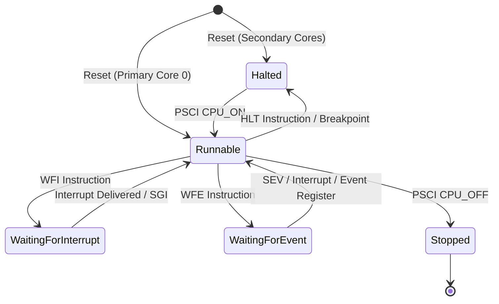

# Multi-Core CPU State Architecture & State Isolation

## 1. Architectural Scope

In an ARMv8-A symmetric multiprocessing (SMP) system, each virtual processing element (PE) maintains independent architectural state across registers, execution levels, condition flags, system control registers, and lifecycle states, while sharing a common physical address space and system interrupt distribution.

The `SmpCoreState` subsystem (`src/cpu/smp_core_state.h`, `src/cpu/smp_core_state.cpp`) provides a self-contained, canonical state representation for any arbitrary number of virtual cores.

---

## 2. Structural Decomposition of `SmpCoreState`

### A1: General-Purpose Registers and Program State
- `x[31]`: 64-bit general-purpose integer registers X0 through X30.
- `pc`: 64-bit program counter.
- `sp_el0`, `sp_el1`, `sp_el2`, `sp_el3`: Banked stack pointers for Exception Levels 0 through 3.
- `nzcv`: 4-bit condition flags (Negative, Zero, Carry, Overflow).
- `daif`: 4-bit interrupt mask bits (Debug, SError, IRQ, FIQ). Masked to `0xF` at reset.
- `sp_sel`: Stack pointer selection flag (`true` = SP_ELx, `false` = SP_EL0).
- `il`: PSTATE.IL (Illegal execution state).
- `pstate_ss`: PSTATE.SS (Software step flag).

### A2: Advanced SIMD & Floating-Point Architecture
- `v[32]`: 128-bit vector/FP registers V0 through V31 (represented as `low`, `high` 64-bit halves).
- `fpcr`: Floating-point control register.
- `fpsr`: Floating-point status register.

### A3: Exception Architecture
- `current_el`: Active Exception Level (EL0, EL1, EL2, or EL3).
- EL1 Exception State: `elr_el1`, `spsr_el1`, `esr_el1`, `far_el1`, `vbar_el1`.
- EL2 Virtualization State: `elr_el2`, `spsr_el2`, `esr_el2`, `far_el2`, `vbar_el2`, `hcr_el2`, `cntvoff_el2`.
- EL3 Secure State: `elr_el3`, `spsr_el3`, `esr_el3`, `far_el3`, `vbar_el3`, `scr_el3`.

### A4: System Control Registers
- `sctlr_el1`: System control register EL1.
- `tcr_el1`: Translation control register EL1.
- `ttbr0_el1`, `ttbr1_el1`: Translation table base registers 0 and 1 EL1.
- `mair_el1`: Memory attribute indirection register EL1.
- `cpacr_el1`: Architectural feature access control register EL1.

### A5: Generic Timer State
- `cntp_cval_el0`, `cntp_ctl_el0`: Physical timer comparator and control register.
- `cntv_cval_el0`, `cntv_ctl_el0`: Virtual timer comparator and control register.

### A6: Lifecycle & Execution Metadata
- `core_id`: Unique core identifier ($0 \le \text{core\_id} < N$).
- `lifecycle`: Execution lifecycle state (`CoreLifecycleState`).
- `instruction_retirement_count`: Total instructions retired by this core.
- `current_budget`: Instruction budget allocated for current scheduling slice.
- `executed_in_quantum`: Instructions executed within current scheduling slice.
- `pending_interrupt`: Flag indicating pending unmasked interrupt signal.

---

## 3. Core Lifecycle State Machine

Each virtual core transitions through well-defined lifecycle states:

| Lifecycle State | Description | Schedulable? |
|---|---|---|
| `Halted` | Inactive, awaiting boot or debug resumption | No |
| `Runnable` | Active and ready to execute instruction slices | **Yes** |
| `WaitingForInterrupt` | Quiescent in WFI; awakens only on pending interrupt | Schedulable only when unmasked interrupt pending |
| `WaitingForEvent` | Quiescent in WFE; awakens on SEV or event register | Schedulable only when event register is set |
| `Stopped` | Terminated via PSCI `CPU_OFF` | No |

---

## 4. Canonical State Hashing

To verify absolute determinism across repeated executions without pointer or host-environment leakage, `SmpCoreState::compute_canonical_hash()` implements a 64-bit FNV-1a hash over all architectural fields in little-endian order:
- `core_id`, `lifecycle`
- Integer registers X0–X30, PC, SP_EL0..3, packed PSTATE
- Vector registers V0–V31, FPCR, FPSR
- Exception registers for EL1, EL2, EL3
- MMU sysregs (SCTLR, TCR, TTBR0/1, MAIR, CPACR)
- Timers (CNTP, CNTV)

**Host Immunity**: Host pointers (e.g. `this`, `Memory*`, `TraceSink`), debug sinks, and transient scheduling metrics (`current_budget`, `executed_in_quantum`) are strictly excluded from the hash computation. Identical architectural states produce identical 64-bit canonical hashes across all host configurations.
