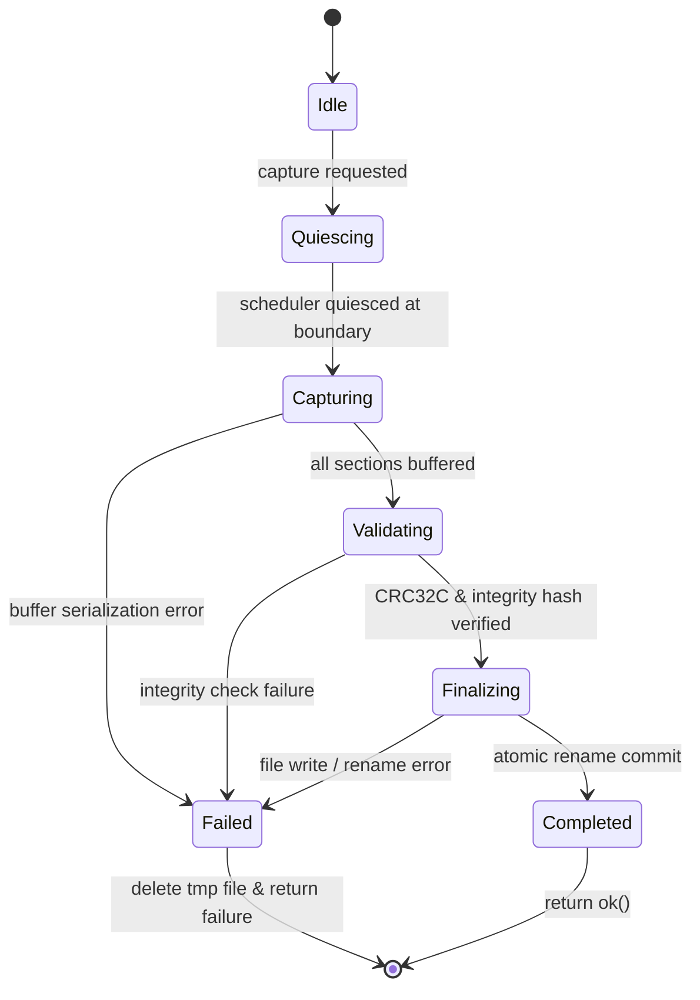

# Atomic Snapshot Capture Protocol

## 1. Design & Protocol Requirements

The WinIOS cluster snapshot capture engine (`SmpSnapshotManager::capture_to_buffer` and `SmpSnapshotManager::capture_to_file`) guarantees transactional atomicity and consistent logical instant state capture.

A failed capture must never leave a corrupted or partially written `.wsnap` file on disk.

---

## 2. Capture Transaction State Machine

---

## 3. Transaction Steps

1. **Quiescence**: In single-host-thread deterministic scheduling, capture occurs strictly between instruction steps or between quantum slices. No instruction is mid-execution.
2. **State Harmonization**: For each registered core slot, `slot.state.capture_from_cpu(*slot.cpu)` synchronizes live CPU registers to `SmpCoreState`.
3. **In-Memory Buffering**: All required sections (`Metadata`, `CoreDirectory`, `CoreArchitecturalState` for cores $0..N-1$, `SharedMemory`, `Scheduler`, `ExclusiveMonitor`, `InterruptRouter`, `Integrity`) are generated as isolated in-memory byte buffers.
4. **Checksum & Hash Calculation**:
   - Calculates CRC32C over each section's payload bytes.
   - Computes canonical multicore hash via `SmpScheduler::compute_canonical_multicore_hash()`.
   - Embeds section CRC table into `Integrity` section.
5. **Container Assembly**:
   - Computes Section Directory Table with offsets and sizes.
   - Computes 64-byte `WSnapHeader` with `version = 2`, `core_count = N`, and header CRC32C.
6. **Atomic File Commit**:
   - Writes complete buffer to a temporary file `<target>.tmp`.
   - Flushes and closes file handle.
   - Performs atomic filesystem rename (`std::filesystem::rename`) to `<target>`.
   - If any error occurs, the temporary file is deleted; the live target file remains untouched.
