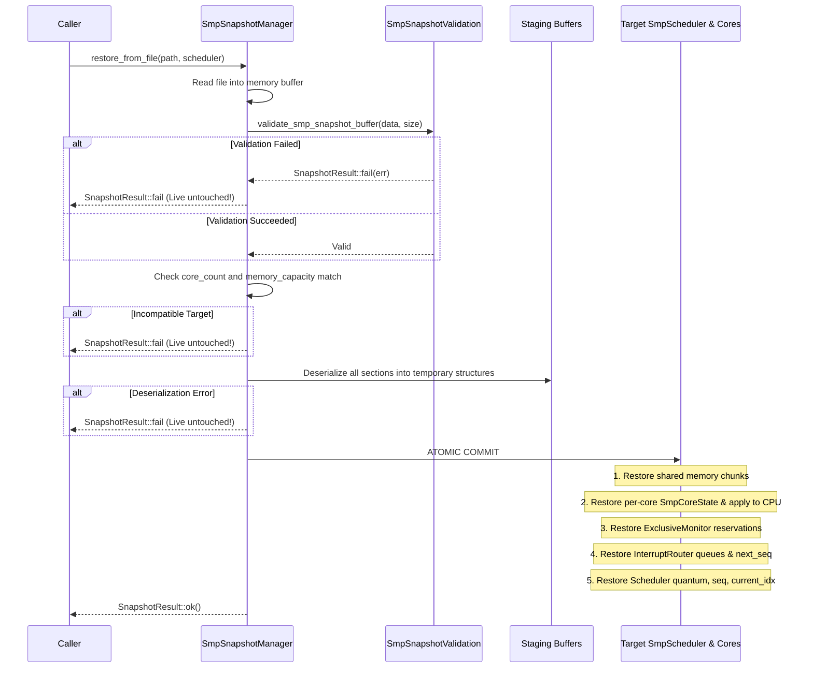

# Atomic Snapshot Restoration Protocol

## 1. Safety & Atomicity Invariant

The cluster restoration engine (`SmpSnapshotManager::restore_from_buffer` and `SmpSnapshotManager::restore_from_file`) guarantees that a live running cluster is never partially overwritten if a snapshot is malformed, corrupted, truncated, or incompatible.

The target cluster remains 100% unaltered until the entire snapshot has passed all syntactic, structural, and semantic validation checks.

---

## 2. Restore Transaction Protocol

---

## 3. Commit Sequence

Once all staging checks pass:
1. **Shared Physical Memory**: `shared_memory().raw_memory()` is zeroed out and populated with sparse chunks.
2. **CPU Cores**: Each slot's `SmpCoreState` is replaced, retirement and quantum metrics are restored, and `state.apply_to_cpu(*slot.cpu)` updates registers, PC, PSTATE, SIMD, and system registers.
3. **Exclusive Monitor**: `exclusive_monitor().reset()` followed by `set_core_reservation()` for all serialized entries.
4. **Interrupt Router**: `interrupt_router().clear_all()`, `set_next_sequence()`, and `restore_queue()` for each core.
5. **Scheduler Coordinator**: Restores `quantum_instructions_`, `global_retirement_sequence_`, and `current_core_index_`.

Test Group H (`H2_CoreCountMismatchFailsCleanly`) explicitly verifies that attempting to restore an incompatible snapshot leaves the target cluster's state and canonical hash completely unaltered.
