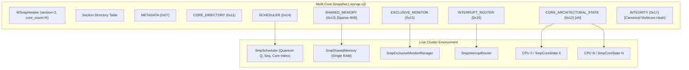

# Cluster Snapshot Architecture

## 1. Architectural Philosophy

The WinIOS Multi-Core Cluster Snapshot subsystem captures and restores the complete multicore execution environment developed in Phase 52 Stage 22 (`SmpCoreState`, `SmpSharedMemory`, `SmpScheduler`, `SmpExclusiveMonitorManager`, `SmpInterruptRouter`).

Key architectural principles:
1. **Single Logical Instant**: Every cluster snapshot represents a consistent logical boundary across all cores.
2. **Single Host Thread Quiescence**: Exploits single-host-thread cooperative execution to ensure that no virtual core is in the middle of executing an instruction when the snapshot is taken.
3. **Single Memory Serialization**: Shared physical memory is serialized exactly once, avoiding $N \times$ memory bloat.
4. **Relational Fidelity**: Preserves cross-core architectural relationships:
   - Exclusive monitor reservations.
   - Pending cross-core interrupts in FIFO queues.
   - Global sequence and round-robin scheduler position.
   - Banked architectural state per core.
5. **Transactional Atomicity**: Complete validation before any mutation of the live cluster during restoration, and atomic file commit during capture.

---

## 2. Cluster Component Map

---

## 3. Snapshot Lifecycles

### Capture Lifecycle
`Idle -> Quiescing -> Capturing -> Validating -> Finalizing -> Completed`
- Captures states of all components into memory buffers.
- Verifies CRC32C of all sections and calculates canonical multicore hash.
- Writes to temporary file `<output>.tmp`, verifies disk write, and performs atomic rename.

### Restore Lifecycle
`Validating -> Staging -> Cross-Verification -> Committing -> Active`
- Validates file format, directory bounds, and payload CRC32C without touching target.
- Deserializes into staging data structures.
- Verifies compatibility with target scheduler (core count, memory size).
- Atomically commits state to shared memory, virtual CPUs, monitor, interrupt router, and scheduler.
