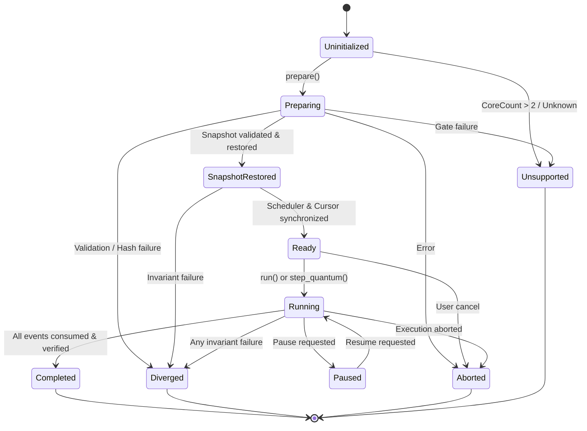

# WinIOS Phase 52 Stage 26 — Replay State Machine Specification

## 1. State Machine Definitions

The multicore deterministic replay engine is governed by a formal state machine (`SmpReplayState`) defined in `src/replay/smp_replay_types.h`. Every transition is validated by `is_valid_smp_replay_transition(from, to)`.

### 1.1 State Registry

| State | Numeric | Category | Description |
|---|---|---|---|
| `Uninitialized` | 0 | Initial | Fresh coordinator instance before preparation. |
| `Preparing` | 1 | Ephemeral | Active file validation, capability gate checking, and memory allocation. |
| `SnapshotRestored` | 2 | Intermediate | Initial baseline snapshot validated and committed to virtual cluster. |
| `Ready` | 3 | Stable | Fully synchronized and prepared to begin or resume execution. |
| `Running` | 4 | Active | Replay loop executing quantums and consuming events. |
| `Paused` | 5 | Quiescent | Execution paused between quantum boundaries. |
| `Completed` | 6 | Terminal | Successful replay completion; all events consumed and final invariants verified. |
| `Diverged` | 7 | Terminal | Architectural mismatch detected; execution halted safely. |
| `Aborted` | 8 | Terminal | Session terminated externally or due to fatal resource exhaustion. |
| `Unsupported` | 9 | Terminal | Capability gate rejected configuration (e.g. core count > 2). |

---

## 2. Invariant Rules and Prohibitions

1. **Terminal State Immutability:** Once the replay engine enters `Completed`, `Diverged`, `Aborted`, or `Unsupported`, no further state transitions are permitted (`is_valid_smp_replay_transition` returns `false`).
2. **Completion Invariant:** The replay engine can **never** transition to `Completed` if:
   - Unconsumed records remain in the SNDL v2 event cursor (`cursor.has_next() == true`).
   - The footer completion status was not `Completed`.
   - The final global retirement sequence does not match the recorded footer sequence.
   - Any virtual core retired an unexpected number of instructions.
   - A divergence occurred at any instruction or quantum boundary.
3. **Immediate Divergence Halt:** Upon any mismatch (event type, sequence gap, core attribution, quantum budget, truncation reason, or retirement count), the engine immediately records an `SmpReplayDivergence` payload and transitions to `Diverged`. No subsequent instructions or quantums are executed.
